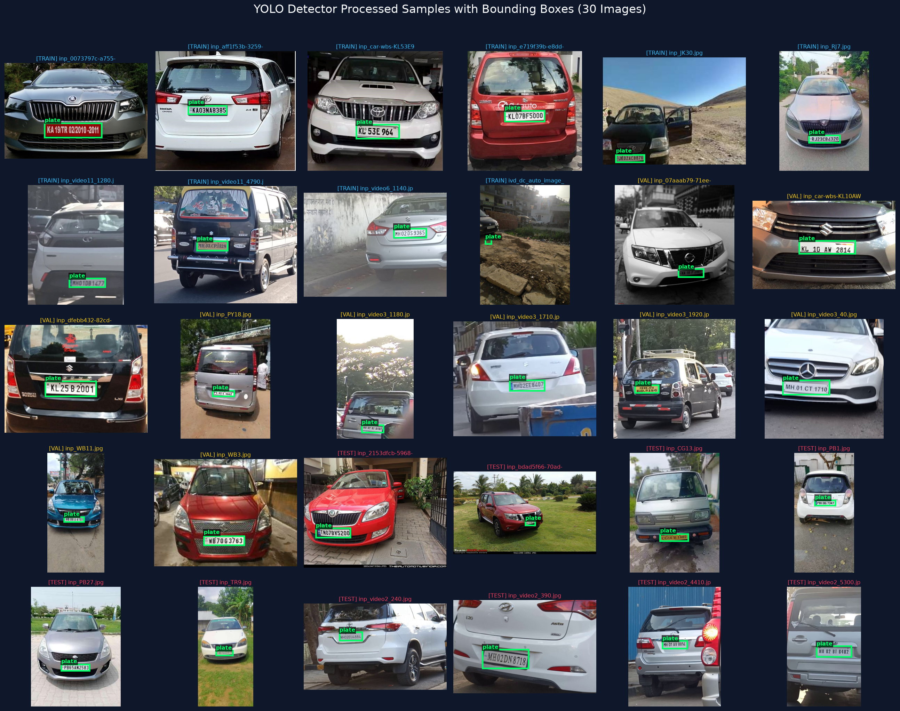
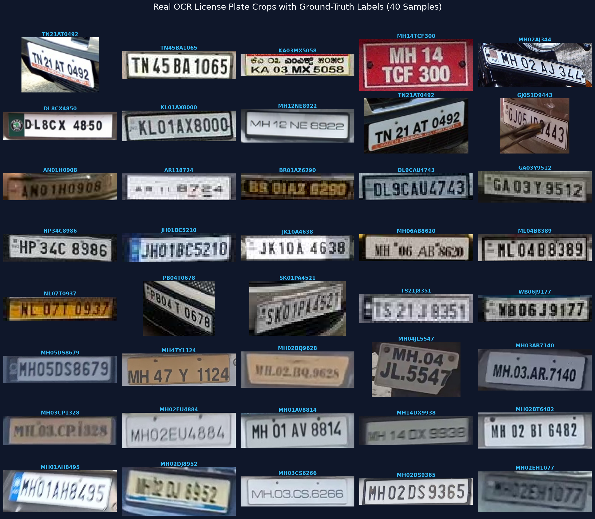
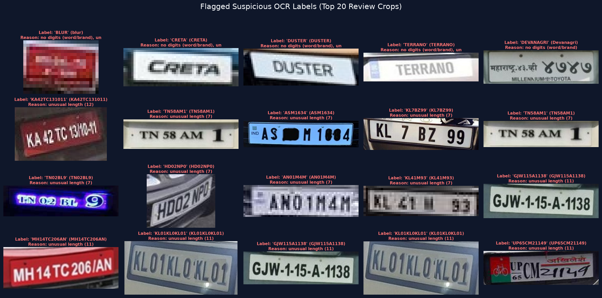
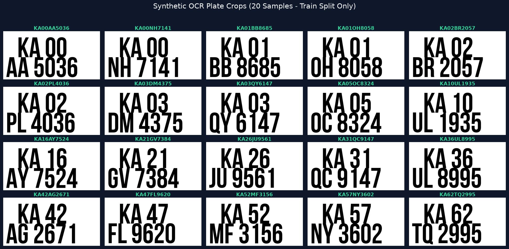
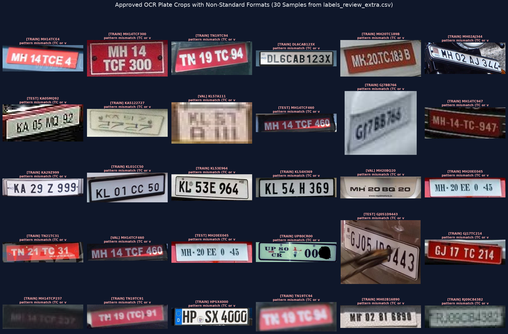

# City-ANPR Data Preparation Report

This report summarizes the data preparation, quality assurance, sanity checks, deduplication, and group-based splitting performed on raw datasets for License Plate Detection (YOLO) and Optical Character Recognition (OCR).

---

## 1. Executive Summary

| Dataset Task | Train | Validation | Test | Total Items | Format |
| :--- | :--- | :--- | :--- | :--- | :--- |
| **Plate Detector (YOLO)** | **1467** (79.9%) | **184** (10.0%) | **184** (10.0%) | **1835** | YOLO format (`images/`, `labels/`), max 1280 px |
| **Real OCR Crops** | **1360** | **168** | **167** | **1695** | PNG crops (+5% padding), `labels.csv` |
| **Real OCR Review Flags** | — | — | — | **40** | Top 40 suspicious labels moved to `labels_review.csv` |
| **Synthetic OCR Crops** | **10400** | **0** | **0** | **10400** | PNG crops, Karnataka `KA00-KA67` prefixes only |
| **Total OCR Dataset** | **11760** | **168** | **167** | **12095** | Combined for OCR training |

> [!IMPORTANT]
> **Strict Split Isolation**: Synthetic plate crops are **strictly constrained to `train/`** and never leaked into `val/` or `test/`. The real OCR evaluation splits preserve the exact group-clustering assignments established by the plate detector, ensuring that no real test plate was seen during detector or OCR training.

---

## 2. Plate Detector Dataset (`data/processed/detector/`)

### Input Sources & Contributions
1. **`license-plate-detection/`**: Real vehicle photos with YOLO format annotations (`class 0: plate`).
2. **`indian-number-plates-dataset/`**: Pascal VOC XML annotations with diverse Indian traffic cameras, OLX listings, and street scenes.
3. **`indian-vehicle-dataset/`**: Pascal VOC XML high-resolution images (resized from 3264x2448 down to 1280 px).

### Group-Based Splitting Strategy
- **Video & Series Grouping**: Video sequence frames from `video_images` (e.g., `video10`, `video11`, `car-wbs-MH01DE2780`) were grouped together using filename prefix matching and Union-Find clustering.
- **Perceptual Hash Proximity**: Candidate frames with difference hash (dHash) Hamming distance $\le 4$ were joined into the same group.
- **Zero Leakage**: All frames belonging to the same series/scene are assigned exclusively to either `train`, `val`, or `test`.

```yaml
# data/processed/detector/data.yaml
path: ../detector
train: images/train
val: images/val
test: images/test

names:
  0: plate
```

### Visual Verification


---

## 3. Data Cleaning & Excluded Items

During ingestion and sanity checking, invalid boxes, tight crops, corrupted files, and perceptual duplicates were identified and excluded:

| Removal Reason | Count | Action Taken |
| :--- | :--- | :--- |
| **Missing label file** | 62 | Excluded from detector (found in `license-plate-detection/images`) |
| **Box area > 40% of image** | 1,842 | Excluded (tight plate crops erroneously included in detection dataset) |
| **Exact perceptual duplicate (dist = 0)** | 62 | Excluded duplicate, preserved primary copy |
| **Near perceptual duplicate (dist $\le$ 2)** | 12 | Excluded near-identical duplicate frames |
| **Tiny boxes ($< 10$ px or area $< 100$ px²)** | 3 | Excluded unresolvable bounding boxes |

### Sample Excluded Images (Missing Label File)
`License (943).png`, `License (944).png`, `License (945).png`, `License (946).png`, `License (947).png`, `License (948).png`, `License (949).png`, `License (95).png`, `License (950).png`, `License (951).png`... (62 images total).

---

## 4. Real OCR Plate Crops (`data/processed/ocr/real/`)

From the 1,698 real photos in `indian-number-plates-dataset`, license plates were extracted using Pascal VOC bounding boxes with **5% boundary padding** to ensure edge characters are preserved during perspective transformation.

### Label Quality Findings
- **Standard Regex Pattern**: `^[A-Z]2[0-9](1, 2)[A-Z](0, 3)[0-9]4$`
- **Regex Conformance**: **93.4%** (1,585 plates match standard Indian High-Security Registration Plate format).
- **Character Set Found**: 36 alphanumeric characters (`0-9`, `A-Z`).

### Length Distribution (Approved Plates)
| Character Length | Count | Share |
| :--- | :--- | :--- |
| **8 characters** | 50 | 3.0% |
| **9 characters** | 415 | 25.0% |
| **10 characters** | 1,192 | 71.9% |

### Top 40 Suspicious Labels Flagged for Review (`labels_review.csv`)
Rather than silently dropping irregular annotations, the 40 most suspicious labels have been isolated into `data/processed/ocr/real/labels_review.csv` for human verification:

| # | Normalized Label | Raw Text | Length | Reason Flagged |
| :--- | :--- | :--- | :--- | :--- |
| 1 | `BLUR` | `blur` | 4 | no digits (word/brand), unusual length (4) |
| 2 | `CRETA` | `CRETA` | 5 | no digits (word/brand), unusual length (5) |
| 3 | `DUSTER` | `DUSTER` | 6 | no digits (word/brand), unusual length (6) |
| 4 | `TERRANO` | `TERRANO` | 7 | no digits (word/brand), unusual length (7) |
| 5 | `DEVANAGRI` | `Devanagri` | 9 | no digits (word/brand) |
| 6 | `KA42TC131011` | `KA42TC131011` | 12 | unusual length (12) |
| 7 | `TN58AM1` | `TN58AM1` | 7 | unusual length (7) |
| 8 | `ASM1634` | `ASM1634` | 7 | unusual length (7) |
| 9 | `KL7BZ99` | `KL7BZ99` | 7 | unusual length (7) |
| 10 | `TN58AM1` | `TN58AM1` | 7 | unusual length (7) |
| 11 | `TN02BL9` | `TN02BL9` | 7 | unusual length (7) |
| 12 | `HD02NP0` | `HD02NP0` | 7 | unusual length (7) |
| 13 | `AN01M4M` | `AN01M4M` | 7 | unusual length (7) |
| 14 | `KL41M93` | `KL41M93` | 7 | unusual length (7) |
| 15 | `GJW115A1138` | `GJW115A1138` | 11 | unusual length (11) |
| 16 | `MH14TC206AN` | `MH14TC206AN` | 11 | unusual length (11) |
| 17 | `KL01KL0KL01` | `KL01KL0KL01` | 11 | unusual length (11) |
| 18 | `GJW115A1138` | `GJW115A1138` | 11 | unusual length (11) |
| 19 | `KL01KL0KL01` | `KL01KL0KL01` | 11 | unusual length (11) |
| 20 | `UP65CM21149` | `UP65CM21149` | 11 | unusual length (11) |
| 21 | `AR08983` | `AR08983` | 7 | unusual length (7) |
| 22 | `KA19TR02` | `KA19TR02` | 8 | pattern mismatch |
| 23 | `DL758Y1790` | `DL758Y1790` | 10 | pattern mismatch |
| 24 | `TN21TC611` | `TN21TC611` | 9 | pattern mismatch |
| 25 | `DL14CTC0153` | `DL14CTC0153` | 11 | unusual length (11) |
| 26 | `DL6CAB123X` | `DL6CAB123X` | 10 | pattern mismatch |
| 27 | `W0BNP300` | `W0BNP300` | 8 | pattern mismatch |
| 28 | `MH14TCD204` | `MH14TCD204` | 10 | pattern mismatch |
| 29 | `TN19TC91` | `TN19TC91` | 8 | pattern mismatch |
| 30 | `MH20TC640B` | `MH20TC640B` | 10 | pattern mismatch |
| 31 | `MH15TC554` | `MH15TC554` | 9 | pattern mismatch |
| 32 | `KL01CC50` | `KL01CC50` | 8 | pattern mismatch |
| 33 | `KL53E964` | `KL53E964` | 8 | pattern mismatch |
| 34 | `KL54H369` | `KL54H369` | 8 | pattern mismatch |
| 35 | `KL01KLKL01` | `KL01KLKL01` | 10 | pattern mismatch |
| 36 | `KL01AU585` | `KL01AU585` | 9 | pattern mismatch |
| 37 | `MH14TCF459` | `MH14TCF459` | 10 | pattern mismatch |
| 38 | `MH15TC554` | `MH15TC554` | 9 | pattern mismatch |
| 39 | `KA29Z999` | `KA29Z999` | 8 | pattern mismatch |
| 40 | `MH20TC830C` | `MH20TC830C` | 10 | pattern mismatch |

### Visual Verification of Real OCR Crops


### Visual Verification of Flagged Suspicious Crops


---

## 5. Synthetic OCR Dataset (`data/processed/ocr/synthetic/`)

- **Total Plates**: 10,400 synthetic plate images.
- **Assigned Split**: **100% `train/`** (0 in `val`, 0 in `test`).
- **Normalized Prefix Distribution**:
  - Distinct 4-character prefixes: **68** (spanning `KA00` through `KA67`).
  - All 10,400 plates belong to Karnataka state registration codes (`KA`).
  - Distribution breakdown:
    - `KA00`: 1,000 plates
    - `KA01`: 1,000 plates
    - `KA02`: 1,000 plates
    - `KA03`: 1,000 plates
    - `KA04` – `KA67`: 100 plates each (64 × 100 = 6,400 plates).
    - Total: 4,000 + 6,400 = **10,400 plates**.

### Visual Verification of Synthetic OCR Crops


---

## 6. Colab Package Archive (`data/processed_for_colab.zip`)

To facilitate training on cloud GPUs (e.g. Google Colab / Kaggle), the entire processed dataset has been bundled into `data/processed_for_colab.zip`.

- **Archive Location**: `data/processed_for_colab.zip`
- **Contents**:
  - `detector/images/{train, val, test}` + `detector/labels/{train, val, test}` + `detector/data.yaml`
  - `ocr/real/{train, val, test}` + `ocr/real/labels.csv` + `ocr/real/labels_review.csv`
  - `ocr/synthetic/train/` + `ocr/synthetic/labels.csv`
  - `ocr/labels.csv` (Unified labels)
  - `split_groups.json` (Group assignments and metadata)

---
*Report generated automatically by `ocr/make_data_report.py`.*


---


---

## 7. Label Leakage & Extra Review Audit (`check_label_leakage.py`)

This audit investigates text-level overlap across splits and documents approved labels with non-standard registration syntax without altering any physical file assignments.

### 1. Plate Text Overlap Across Splits
While camera/video series groups prevent identical frames from crossing splits, different web images and OLX ads sometimes capture the same physical car from different angles.

- **Validation Crops with Text Seen in Train**: **27** / 167 (16.2%)
- **Test Crops with Text Seen in Train**: **21** / 164 (12.8%)
- **Total Overlapping Val/Test Crops**: **48**
- **Action Taken**: Added boolean column `text_seen_in_train` to `labels.csv` (`True` if the text appears anywhere in the training set; `False` if completely novel to validation/testing). This enables evaluators to measure OCR performance on both seen and unseen plate strings separately.

#### 20 Examples of Overlapping Plate Texts:
| # | Split | Plate Text | File Name |
| :--- | :--- | :--- | :--- |
| 1 | `val` | `KA18P2987` | `07aaab79-71ee-4ea3-a9e6-640191183947___3e7fd381-0ae5-4421-8a70-279ee0ec1c61_1208484d1392541449-nissan-terrano-official-review-img_20140215_181708_crop.png` |
| 2 | `val` | `MH20CS1941` | `11186c4c-5f17-49b1-af37-a138a1e53794___12837944763_e7c6c6381a_z.jpg_crop.png` |
| 3 | `val` | `MH20BY4465` | `2302b12c-3d74-4d6c-b376-ba8ab308a8c3___big_215451_1320738450.jpg_crop.png` |
| 4 | `val` | `HR11F7575` | `5231116f-7a07-4ce2-b437-d34b497e7969___3e7fd381-0ae5-4421-8a70-279ee0ec1c61_844329566_3_1080x720_nissan-terrano-xe-d-2014-diesel-_crop.png` |
| 5 | `val` | `MH14EP4660` | `52abe2c4-fde3-45b2-beec-f070e6ed98c7___Volkswagen-Vento-Rear-view-46765.jpg_crop.png` |
| 6 | `val` | `KL10AV6342` | `5747d3e8-4dd0-435f-942d-34b84f03344c___Maruti-Suzuki-Swift-Number-Plates-Design.jpg_crop.png` |
| 7 | `val` | `UP16CT2233` | `57e92915-935a-4a91-91f8-f3ad70040a6e___3e7fd381-0ae5-4421-8a70-279ee0ec1c61_847071203_1_1080x720_nissan-terrano-xv-d-thp-premium-110-ps-2015-diesel-ghaziabad_crop.png` |
| 8 | `val` | `RJ02CC0784` | `760ba77a-8992-4574-8cba-6c081d9e3e19___3e7fd381-0ae5-4421-8a70-279ee0ec1c61_04f4c639c871fba0b4cc6475604e40b7_large_crop.png` |
| 9 | `val` | `HR696969` | `8b9e7112-9149-48fb-b8e8-c3e89cce5af0___1074650_10201043987997310_227646612_o.jpg_crop.png` |
| 10 | `val` | `MH20CS4946` | `af608b5e-07d6-4bcf-84d0-f0cba9e54e12___Skoda-Superb-Rear-Profile.jpg_crop.png` |
| 11 | `test` | `TN37CR4019` | `23d775eb-842f-4f57-ad7a-affafa21660a___215453-new-2016-maruti-ertiga-granite-grey-zdi-shvs-highway-champion-img_8168.jpg_crop.png` |
| 12 | `test` | `MH14EU3498` | `2adfb5e7-e70a-4749-b5fa-8c233c0d47d9___new_1572920d1478091901-your-favourite-number-plate-font-jetta-german-font.jpg_crop.png` |
| 13 | `test` | `WB06F9209` | `3fd93f90-f778-4f14-8b0f-67dd0be88a06___561644d1308248087-beware-fake-registration-numbers-imported-cars-proof-pg-3-257491_10150223034216705_685851704_7325894_6829197_o.jpg_crop.png` |
| 14 | `test` | `MH02CB4545` | `4eb236a3-6547-4103-b46f-3756d21128a9___06-Sanjay-Dutt.jpg_crop.png` |
| 15 | `test` | `MH14EH7958` | `5b49ae32-c799-45e3-b139-9c56acf6370d___2014-Volkswagen-Polo-Review.jpg_crop.png` |
| 16 | `test` | `HR26DK0830` | `5cbd7465-ad12-4e6b-8eaf-d7056c3852f8___New-2018-Maruti-Suzuki-Swift-radiator-grille-600x398.jpg_crop.png` |
| 17 | `test` | `MH01BU5207` | `7f369852-27b9-4141-8c48-9e88b20743a6___new_Mahindra-Scorpio-Taillamps-Night.JPG_crop.png` |
| 18 | `test` | `MH02BM5048` | `967ba4a0-eb8e-4734-aa09-c7143d0404b6___39720161008_150234.jpg_crop.png` |
| 19 | `test` | `TN38BY4191` | `a2d49f53-4121-4627-b5d9-069f8b2f8490___840256171_1_1080x720_maruti-suzuki-wagon-r-vxi-with-abs-minor-2014-petrol-erode.jpg_crop.png` |
| 20 | `test` | `KL454455` | `b5b41a4b-8913-4af6-9419-ac6398d266b0___161893107_2_1000x700_innava-with-fancy-number-upload-photos.jpg_crop.png` |

### 2. Approved Labels with Non-Standard Formats (`labels_review_extra.csv`)
An inspection of the 1,657 approved real plate labels against `^[A-Z]{2}[0-9]{1,2}[A-Z]{0,3}[0-9]{4}$` identified **74** labels (4.5%) with unusual structures:
- **Train split**: 62 suspicious labels
- **Validation split**: 6 suspicious labels
- **Test split**: 6 suspicious labels

> [!NOTE]
> **Why they differ**: Most non-matching labels are legitimate Indian Trade Certificate (TC) dealer plates (e.g., `MH14TCE4`, `MH14TCF300`, `TN19TC94`) or vintage registrations with 2–3 trailing digits (`KA05MQ92`, `KL57A111`, `MH02AJ344`).
> Rather than deleting them, they are flagged with `suspicious=True` in `labels.csv` and exported to `data/processed/ocr/real/labels_review_extra.csv`.



### 3. Top 15 Most Frequent Plate Texts
The most frequently observed plate strings in real crops and their split distribution:

| Rank | Plate Text | Occurrences | Splits Found | Multi-Split? |
| :--- | :--- | :--- | :--- | :--- |
| 1 | `MH47Y1124` | 41 | `train` | No (Isolated) |
| 2 | `MH02BT6482` | 41 | `test, val` | **YES** (Cross-Split) |
| 3 | `MH02DS9365` | 34 | `train` | No (Isolated) |
| 4 | `MH03CS6266` | 27 | `train` | No (Isolated) |
| 5 | `MH02BQ9628` | 20 | `train` | No (Isolated) |
| 6 | `MH02ER9194` | 19 | `val` | No (Isolated) |
| 7 | `RJ27TC0530` | 18 | `train` | No (Isolated) |
| 8 | `MH01AU0059` | 17 | `train` | No (Isolated) |
| 9 | `MH4705851` | 17 | `train` | No (Isolated) |
| 10 | `MH03BS4060` | 16 | `train` | No (Isolated) |
| 11 | `MH02DN8718` | 14 | `test` | No (Isolated) |
| 12 | `MH01AX3070` | 13 | `train` | No (Isolated) |
| 13 | `MH01AV7461` | 12 | `train` | No (Isolated) |
| 14 | `MH47AV6753` | 11 | `train` | No (Isolated) |
| 15 | `MH02EE8407` | 11 | `val` | No (Isolated) |
