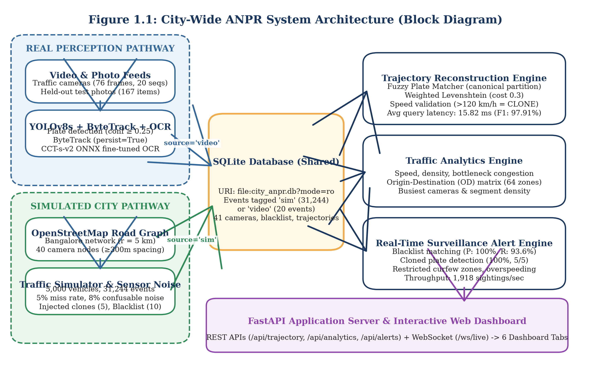
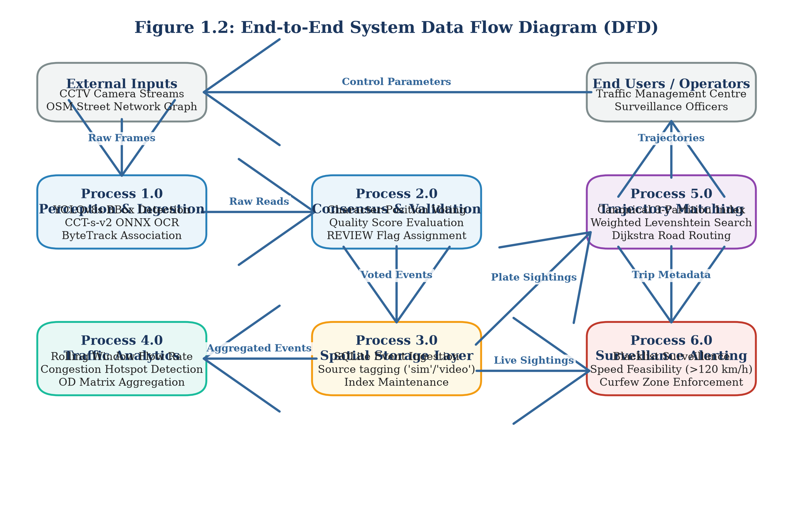

# 1. INTRODUCTION

## 1.1 Introduction

Urban transportation networks in modern metropolitan centres handle millions of vehicular trips every day. Rapid vehicular expansion strains existing arterial road corridors, resulting in severe traffic congestion, elevated carbon emissions, transit delays, and elevated road accident rates. Effective metropolitan traffic governance demands real-time situational awareness across dozens or hundreds of distributed monitoring locations. Municipal authorities increasingly deploy automated number-plate recognition (ANPR) camera networks across key intersections, toll barriers, arterial entry corridors, and expressway flyovers to track traffic density, identify stolen or wanted vehicles, and support incident investigations.

Traditional ANPR deployments operate primarily as isolated, point-based optical sensors. A standalone camera captures passing vehicles, runs an onboard character recognition algorithm, and logs single-point sightings into a siloed database. While single-point logging confirms that a specific vehicle passed an isolated checkpoint at a given timestamp, it cannot reconstruct the vehicle's spatial journey across the wider urban road network. Isolated cameras fail to reveal route progression, average transit velocities across intermediate road segments, or systemic congestion bottlenecks that develop between sensors. Furthermore, municipal operators face an unmanageable volume of raw plate sightings, making manual cross-camera correlation impractical during urgent law-enforcement investigations or city-scale traffic planning.

In this project, we design, build, and evaluate an integrated city-wide artificial intelligence engine that bridges the gap between single-camera computer vision and macroscopic urban traffic intelligence. The system couples deep-learning visual perception with graph-theoretic trajectory reconstruction, high-throughput spatial storage, automated multi-rule surveillance alerting, and interactive web visualization. By unifying edge perception with central graph analytics, the platform converts discrete, noisy sensor sightings into coherent vehicular journeys, computes empirical traffic flow metrics, and automatically detects high-priority security anomalies in real time.

## 1.2 Major Challenges

Developing an end-to-end city-wide ANPR intelligence system presents substantial theoretical and engineering hurdles across computer vision, distributed data engineering, and spatial graph algorithms.

### 1.2.1 Real-World License Plate Optical Character Recognition
Accurate optical character recognition (OCR) of vehicle registration plates under real-world traffic conditions remains notoriously difficult. In developing countries such as India, vehicle license plates exhibit high structural variability. While the central government mandates standardised High-Security Registration Plates (HSRP) conforming to regular alphanumeric regex patterns, millions of vehicles still carry older or non-standard plates. These display non-standard typefaces, non-uniform character kerning, regional state prefixes, trade certificate (TC) dealer notations, and custom decorative styling. 

Furthermore, outdoor roadside cameras capture moving vehicles across diverse illumination regimes, ranging from harsh midday glare to deep nighttime shadows. Optical sensors encounter severe perspective distortion due to camera mounting angles, motion blur from high-speed travel, lens dirt, rain precipitation, and partial occlusions by vehicle bodywork or tow bars. As our empirical benchmarks demonstrate, standard off-the-shelf OCR engines achieve less than 38% exact plate match accuracy on real Indian road crops without domain-specific training. A single misread character invalidates the entire registration string, breaking cross-camera identification.

### 1.2.2 Tracking and Identity Preservation Across Cameras
Maintaining vehicle identity across non-overlapping, distributed camera views represents a core research challenge in intelligent transportation systems. Multi-target multi-camera (MTMC) tracking typically relies on visual vehicle re-identification (Re-ID) algorithms that extract deep appearance embeddings from vehicle bodywork. However, urban vehicle fleets exhibit immense intra-class visual similarity: thousands of commercial hatchbacks and sedans share identical paint codes, chassis silhouettes, and trim packages. Visual appearance alone cannot reliably distinguish two silver hatchbacks traversing parallel arterial corridors.

License plate text provides the single definitive unique identifier for motor vehicles. Nevertheless, because cameras are spaced hundreds of metres or several kilometres apart, continuous video tracking is impossible between camera blind spots. When OCR engines generate noisy or corrupted plate strings, simple exact-match SQL queries fail to reconnect sightings belonging to the same journey. Resolving identity across disjoint cameras demands fault-tolerant fuzzy string matching coupled with physical velocity validation across the underlying road network graph.

### 1.2.3 Privacy Considerations and Operator Data Protection
Automated vehicle tracking across urban road networks raises significant civil liberty, personal privacy, and data protection concerns. Continuous vehicular trajectory logging creates a detailed record of private citizens' daily movements, dwelling locations, places of work, and personal habits. Compromise of an unencrypted central ANPR repository could expose sensitive citizen travel histories to unauthorised surveillance or commercial exploitation.

To maintain ethical compliance and alignment with emerging data protection regulations, an intelligent ANPR platform must incorporate strict privacy-by-design safeguards. Visual vehicle photographs must restrict operator access to cropped plate regions rather than full cabin views, driver faces must be obscured, and automated journey searches must enforce role-based access control. Furthermore, public data releases and evaluation benchmarks must anonymise personal registration strings, and system export functions must sanitise data outputs to prevent formula injection attacks against municipal spreadsheet applications.

### 1.2.4 Absence of Labelled City-Scale ANPR Trajectory Data
Supervised machine learning algorithms require large, accurately annotated training datasets. While isolated benchmarks exist for single-image vehicle plate detection (such as the CCPD or Indian Number Plate datasets), no publicly available, fully labelled dataset provides ground-truth vehicle trajectories linked to optical camera video feeds across a complete metropolitan street network. Real municipal ANPR feeds are strictly restricted due to statutory privacy laws and national security constraints.

Existing open urban trajectory benchmarks, such as the Jinan city dataset published by Yu et al. in 2023 [1], capture macroscopic vehicle trips across thousands of road network nodes. However, these datasets strip license plate strings, omit raw camera imagery, and obscure calendar dates to protect driver privacy. Conversely, computer vision benchmarks, such as the IEEE AI City Challenge [8], offer rich multi-camera video streams but restrict evaluation to localised intersection zones without city-scale trajectory ground truth. Developing and verifying an integrated city-wide ANPR engine therefore requires constructing a rigorous, synthetic road network simulator that models realistic vehicle mobility, camera placements, and sensor noise while validating visual perception components against real-world video footage.

## 1.3 Proposed Solutions and Key Contributions

To address these interconnected challenges, we design a dual-pathway architecture that combines physical camera vision with macroscopic spatial graph modeling. The primary technical contributions of this work are as follows:

1. **Dual-Pathway Perception and Simulation Architecture:** We implement a modular architecture where real-world video feeds and synthetic city-scale mobility streams converge into a unified spatial database (`data/city_anpr.db`). This allows municipal operators to run identical trajectory reconstruction, flow analytics, and surveillance alerting engines over both physical camera streams and simulated urban fleets.
2. **Deep-Learning Perception Pipeline with Quality Assurance Review:** We train and deploy a custom YOLOv8s license plate detector alongside an ONNX-optimized Compact Convolutional Transformer (CCT-s-v2) optical character recogniser. We implement a multi-frame temporal voting module that aggregates ByteTrack tracking sequences using character-position weighted consensus. To prevent automated misclassification from corrupting municipal records, we introduce an automated `REVIEW` flag that isolates any plate read where OCR confidence or vote margin falls below 0.80.
3. **High-Throughput Fuzzy Trajectory Reconstruction Engine:** We develop a graph-theoretic journey router that queries OpenStreetMap road networks extracted via OSMnx. To overcome optical character corruptions, we build a canonical 3-partition fuzzy string index that searches plates within a weighted Levenshtein distance of 1.0 (with 0.3 penalty for confusable character substitutions like $O \leftrightarrow 0$ and $B \leftrightarrow 8$). The engine filters temporal duplicates, splits journeys exceeding 30 minutes of inactivity, and validates implied hop velocity against shortest-path road geometry.
4. **Real-Time Multi-Rule Surveillance Alert Engine:** We design an event-driven surveillance engine that evaluates incoming sightings against multiple concurrent security rules, including exact and fuzzy blacklist matching, speed-feasibility cloned-plate anomaly detection (>120 km/h), prohibited vehicle curfew zones, and overspeeding. A 10-minute sliding window suppresses redundant alarms, delivering zero false alarms on verified fleet movements.
5. **Calibrated Vehicle Movement Counting Prototype:** We construct a standalone vehicle counting module benchmarked against the IEEE AI City Challenge 2021 Track 1 dataset. We demonstrate that visual movement estimation yields severe spatial mismatch, whereas empirical trajectory calibration on the initial segment of a video improves directional counting F1-score from 17.9% to 65.1% on held-out test frames.
6. **Unified Web Application and Streaming Interface:** We deploy all backend analytical services behind an asynchronous FastAPI server. The system exposes RESTful endpoints, streaming WebSockets, and an interactive HTML5/Leaflet dashboard supporting live map exploration, trajectory polylines, congestion heatmaps, and direct single-image inference.

## 1.4 Background and Motivation

The motivation for this project stems from the operational realities of municipal Traffic Management Centres (TMC) in rapidly expanding metropolitan areas. In cities such as Bangalore, traffic police command centres manage feeds from hundreds of roadside CCTV cameras. Operators face two primary operational bottlenecks: fragmented surveillance workflows and lagging macroscopic traffic intelligence.

In typical surveillance scenarios—such as tracking a stolen vehicle, identifying a hit-and-run suspect, or tracing an abducted child's vehicle—investigators must manually inspect recorded footage camera by camera. Operators manually note vehicle timestamps, estimate possible travel corridors, and telephone neighbouring control rooms to check downstream camera logs. This fragmented process introduces critical delays during golden-hour emergency responses. If a roadside camera misreads an '8' as a 'B' or an 'O' as a '0', standard database lookup queries return zero records, and the vehicle's trail goes cold. An automated trajectory engine capable of fuzzy character resolution, topological graph routing, and instant impossible-speed clone detection provides immediate operational value to law-enforcement personnel.

Concurrently, urban planners require macroscopic traffic flow metrics to design signal timing schedules, implement congestion pricing, and identify bottleneck corridors. Traditional loop detectors and pneumatic road tubes are expensive to install, vulnerable to asphalt resurfacing damage, and incapable of identifying vehicular origin-destination (OD) patterns. Because ANPR cameras capture unique vehicular identifiers across space and time, an aggregated ANPR stream naturally yields comprehensive OD matrices, link travel times, and intersection level-of-service (LOS) metrics without extra road hardware. Connecting computer vision directly to urban graph analytics creates a cost-effective, dual-use platform serving both law enforcement and municipal urban planning.

## 1.5 Overview of the Proposed System

The proposed system comprises nine modular subsystems organised into visual perception, spatial persistence, graph analytics, and web presentation. Figure 1.1 illustrates the comprehensive block diagram of the system architecture, detailing the convergence of the real perception pathway and the simulated city pathway into the shared spatial database.

Figure 1.1: City-Wide ANPR System Architecture (Block Diagram)

As shown in Figure 1.1, the system processes two distinct data pipelines:
- **Real Perception Pathway:** Video feeds (such as the 20 test sequences in `video_images`) or single photographs pass through the fine-tuned YOLOv8s detector to isolate license plate bounding boxes with a confidence threshold of 0.25. The bounding boxes receive a 5% expansion to prevent character clipping before entering ByteTrack for temporal tracking. The CCT-s-v2 recogniser transcribes character sequences, which are aggregated across frames using positional weighted voting. Events with OCR confidence or vote margin below 0.80 receive an automated `REVIEW` flag. Verified events are written to the database with `source='video'`.
- **Simulated City Pathway:** A 5 km radius street network centered on Bangalore is downloaded from OpenStreetMap via OSMnx [7] and modeled as a directed MultiDiGraph. Forty camera nodes are placed at major arterial intersections with a minimum spacing of 300 metres. A synthetic fleet of 5,000 vehicles generates 31,244 trips incorporating realistic morning and evening peak congestion. Sensor noise (5% miss rate, 8% confusable character error) and security anomalies (10 blacklist targets, 5 cloned plate pairs) are injected. The resulting events are written to the database with `source='sim'`.

Figure 1.2 details the corresponding end-to-end data flow diagram (DFD), illustrating the transformation of raw sensor inputs through validation, storage, and analytical query engines.

Figure 1.2: End-to-End System Data Flow Diagram (DFD)

Both pathways converge in an embedded SQLite database (`data/city_anpr.db`). Downstream, the Trajectory Reconstruction Engine executes shortest-path Dijkstra routing across precomputed camera paths, applying a canonical 3-partition fuzzy plate search to recover noisy OCR sightings. The Traffic Analytics Engine computes rolling-window speed distributions, congestion severity scores, segment densities, and a $64 \times 64$ Origin-Destination zone matrix. The Alert Engine scans incoming sightings against security watchlists and spatial rules, pushing live JSON notifications over a WebSocket stream (`/ws/live`). An interactive web dashboard visualises the city map, trajectories, congestion heatmaps, and live alert feeds.

## 1.6 Objective of the Work

The specific, measurable objectives of this final-year project are as follows:

1. **High-Accuracy License Plate Detection:** Train and optimize an Ultralytics YOLOv8s object detector on real Indian traffic scenes, achieving greater than 95.0% precision, recall, and mAP@50 on held-out test splits.
2. **Robust Optical Character Recognition:** Fine-tune a lightweight Compact Convolutional Transformer (CCT-s-v2) on real Indian plate crops, targeting greater than 95.0% character-level accuracy and evaluating full-plate exact match performance under single-frame and multi-frame video voting regimes.
3. **Temporal Multi-Frame Consensus Voting:** Implement a confidence-weighted voting module using ByteTrack multi-object tracking to improve video plate recognition accuracy over single-frame baseline reads, coupled with an empirical quality assurance threshold (`REVIEW_CONFIDENCE_THRESHOLD = 0.80`) to isolate low-confidence predictions.
4. **City-Scale Road Network & Fleet Simulation:** Construct a realistic urban traffic simulator on Bangalore's road network using OSMnx, modeling 40 cameras, 5,000 vehicles, realistic diurnal traffic flow, optical sensor noise, and injected security scenarios (stolen vehicles, cloned plates, curfew violations).
5. **Sub-50 Millisecond Trajectory Reconstruction:** Develop a spatial trajectory reconstruction engine that tolerates OCR character corruptions via weighted Levenshtein matching, validates hop speed feasibility (>120 km/h) to isolate cloned plates, and delivers sub-50 ms query response times with F1-score exceeding 90.0%.
6. **Real-Time Surveillance Alert Engine:** Implement a multi-rule surveillance engine capable of processing over 1,000 sightings per second, achieving 100% precision on blacklist alerts with zero false alarms after sliding-window de-duplication.
7. **Directional Vehicle Movement Counting:** Prototype an intersection vehicle counting algorithm on the IEEE AI City Challenge 2021 Track 1 benchmark, establishing an empirical calibration methodology to assign vehicle trajectories to 12 distinct directional movement paths.
8. **Interactive Municipal Command Dashboard:** Expose all analytical models through a unified FastAPI REST and WebSocket gateway, providing municipal operators with a responsive HTML5/Leaflet web dashboard.

## 1.7 Organization of the Report

The remainder of this report is organized into four main chapters and supporting appendices:

- **Chapter 2 (Related Work and Theoretical Study):** Reviews existing literature in automated license plate recognition, multi-object and cross-camera vehicle tracking, macroscopic trajectory datasets, urban traffic analytics, and vehicle counting benchmarks. Formulates the core mathematical equations for computer vision metrics, statistical confidence intervals, and graph routing distance functions. Concludes with a detailed research gap analysis and comparative matrix (Table 2.1) contrasting base papers with our proposed architecture.
- **Chapter 3 (Experimental Study):** Details the complete engineering design, system specifications, hardware/software environments, and dataset curation procedures. Explains the perception pipeline, simulation mechanics, SQLite database schema, trajectory router, alert engine, REST/WebSocket API endpoints, and AI City counting pipeline. Outlines the experimental evaluation protocols and automated test suite.
- **Chapter 4 (Results and Discussions):** Presents comprehensive empirical findings across all modules using concrete, number-backed results labeled REAL, SIMULATED, or SYNTHETIC. Examines detector metrics, OCR training progression, end-to-end photo recognition, multi-frame video voting, trajectory reconstruction accuracy, surveillance alert performance, and AI City movement counting (v1 vs. v2). Provides an honest appraisal of the 90% target, error analysis of misread video sequences, requirements traceability, and system limitations.
- **Chapter 5 (Conclusions and Future Scope):** Summarises the project achievements, synthesises core architectural insights, acknowledges key engineering constraints, and outlines practical directions for future extension, including cross-camera visual Re-ID, directional lane graphs, and real-world municipal validation.
- **Appendices & References:** Includes installation and execution guides (Appendix 1), API endpoint documentation (Appendix 2), core code excerpts (Appendix 3), test suite summaries (Appendix 4), followed by IEEE-formatted references and publication declarations.

