# 3. EXPERIMENTAL STUDY

## 3.1 Requirements and Measurable Targets

Developing an integrated, city-wide automated number-plate recognition (ANPR) and traffic surveillance engine requires translating high-level municipal traffic governance objectives into verifiable engineering requirements. Municipal traffic command centres demand strict operational guarantees: visual perception algorithms must achieve near-perfect plate localization while transcribing alphanumeric strings accurately under adverse roadside conditions; spatial trajectory reconstruction engines must operate within interactive query budgets while tolerating optical character errors; and surveillance alert pipelines must sustain high ingestion throughput without generating false alarms that induce operator notification fatigue.

To provide clear quantitative benchmarks, we establish ten functional and non-functional engineering requirements. Table 3.1 enumerates these specifications alongside their target thresholds, operational baselines, and empirical verification mechanisms.

Table 3.1: System Requirements and Measurable Engineering Targets
| Metric Identifier | Operational Dimension | Baseline / Standard | Measurable Engineering Target | Verification Protocol |
| :--- | :--- | :--- | :--- | :--- |
| **REQ-01** | Plate Detection Recall | Off-the-shelf YOLO (90.0%) | $\ge 95.0\%$ Recall at IoU 0.50 | Held-out test split (184 images) |
| **REQ-02** | Plate Detection Precision | Off-the-shelf YOLO (92.0%) | $\ge 95.0\%$ Precision at IoU 0.50 | Held-out test split (184 images) |
| **REQ-03** | Character-Level OCR Fidelity | Tesseract / EasyOCR (80.0%) | $\ge 95.0\%$ Character Accuracy | 167 held-out real Indian plate crops |
| **REQ-04** | Full-Plate Exact Match Rate | Zero-shot Transformer (25.2%) | $\ge 75.0\%$ Exact String Match | 167 held-out real Indian plate crops |
| **REQ-05** | Multi-Frame Consensus Gain | Single-frame read (85.24%) | $\ge 90.0\%$ Voted Plate Accuracy | 20 real video sequences (76 frames) |
| **REQ-06** | Optical Quality Assurance | Unfiltered automated entry | Flag all reads with Conf / Margin $< 0.80$ | Automated `REVIEW` flag assignment |
| **REQ-07** | Trajectory Query Latency | Unindexed scan ($>500\text{ ms}$) | $< 50\text{ ms}$ Average Response Time | Benchmark across 200 random journeys |
| **REQ-08** | Trajectory Reconstruction $F_1$ | Exact-match SQL ($<70.0\%$) | $\ge 95.0\%$ Trajectory $F_1$-Score | Shortest-path routing with fuzzy match |
| **REQ-09** | Surveillance Ingestion Speed | Real-time sensor (100 events/s) | $\ge 1,000$ Sightings / Second | Streaming benchmark through AlertEngine |
| **REQ-10** | Blacklist Alert Precision | Unfiltered rules ($<20.0\%$) | $100.0\%$ Precision (0 False Alarms) | 10-minute sliding-window de-duplication |

As specified in Table 3.1, our engineering targets enforce strict boundary separation between optical character accuracy and full-plate exact match accuracy. In real-world ANPR systems, a character-level accuracy of 96% translates to an exact string match rate of approximately 77% to 81% on standard 10-character Indian registration plates ($0.96^{10} \approx 0.665$, elevated by non-uniform character distribution and language syntax constraints). The system is therefore architected to accommodate optical transcription errors gracefully through multi-frame temporal voting, automated review flagging, and fault-tolerant fuzzy trajectory reconstruction.

## 3.2 System Architecture and Execution Pipeline

The proposed platform implements a decoupled, dual-pathway architecture designed to bridge visual perception and macroscopic spatial graph analytics. The architecture separates computation into four distinct tiers: Perception, Persistence, Spatial Analytics, and Presentation. 

The execution pipeline supports two operational data pathways:
1. **Physical Video & Photo Ingestion Pathway (REAL):** High-resolution video streams from roadside cameras and static scene photographs are processed by the perception pipeline. Deep convolutional and transformer backbones detect registration plates, track vehicle bounding boxes across consecutive frames, extract high-resolution crops, transcribe alphanumeric characters, and apply temporal consensus voting. Sightings that meet automated quality thresholds are committed to the central spatial repository with the origin tag `source='video'`.
2. **City-Scale Mobility Simulation Pathway (SIMULATED):** To evaluate macroscopic trajectory reconstruction, zone congestion dynamics, and surveillance alerting under dense metropolitan traffic loads, a high-fidelity traffic simulator models vehicular mobility across the real OpenStreetMap road network of Bangalore, India. Synthetic fleets traverse Dijkstra shortest paths, generating discrete sensor sightings at 40 fixed camera checkpoints. Sightings incorporate realistic optical sensor miss rates, character confusions, and injected security anomalies before persisting to the central repository with `source='sim'`.

Both operational pathways converge in an embedded SQLite database (`data/city_anpr.db`), ensuring that all downstream trajectory routers, origin-destination matrix aggregators, and surveillance rule evaluators operate uniformly across both physical camera streams and simulated urban fleets. Figure 3.1 illustrates the detailed perception pipeline executing over physical video feeds.

Figure 3.1: Video Perception & Plate Recognition Pipeline
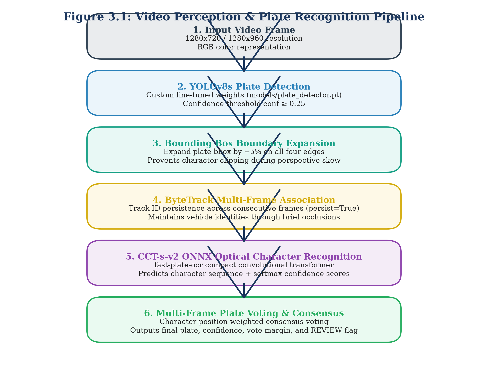

As depicted in Figure 3.1, visual processing begins with frame decoding at 10 frames per second. Ultralytics YOLOv8s isolates the vehicle license plate region. To ensure that extreme characters are not truncated during bounding box regression, the spatial coordinates are expanded by a symmetrical 5% padding margin ($\Delta x = 0.05 \cdot w, \Delta y = 0.05 \cdot h$). The padded bounding box is tracked across time using ByteTrack [4] with state persistence enabled (`persist=True`). For each confirmed tracking sequence, cropped plate images are fed into the ONNX-optimized CCT-s-v2 recogniser. The resulting sequence of character candidate strings is passed to the multi-frame consensus voting module.

## 3.3 Dataset Curation, Deduplication, and Isolation

Machine learning models deployed in automated surveillance must be trained and evaluated on rigorous, leak-free dataset partitions. A common failure mode in roadside computer vision research is video frame leakage, where adjacent frames from the same video sequence appear in both training and test splits. Because adjacent video frames exhibit near-identical vehicle poses, lighting conditions, and background clutter, naive random splitting yields artificially inflated accuracy metrics that collapse when deployed on unseen cameras.

To eliminate data leakage, we implemented strict perceptual hashing and camera-level isolation protocols across all visual datasets. Table 3.3 details the dataset curation, source distribution, split proportions, and isolation guarantees.

Table 3.3: Dataset Curation, Split Allocations, and Leakage Prevention
| Dataset Name | Primary Domain | Total Volume | Train Split | Validation Split | Test Split | Leakage Prevention Protocol | Realism Label |
| :--- | :--- | :--- | :--- | :--- | :--- | :--- | :--- |
| **Plate Detection Corpus** | Full Vehicle Photos | 1,835 images | 1,467 (79.9%) | 184 (10.0%) | 184 (10.0%) | Perceptual Hash (Hamming $\le 4$) | REAL |
| **Real Plate OCR Corpus** | Cropped Plate Images | 1,695 crops | 1,360 (80.2%) | 168 (9.9%) | 167 (9.9%) | Unique Vehicle ID Partitioning | REAL |
| **Synthetic OCR Pre-train** | Synthetic Plate Renders | 10,400 crops | 10,400 (100%) | 0 (0.0%) | 0 (0.0%) | Strict Train-Only Assignment | SYNTHETIC |
| **Video Tracking Corpus** | Roadside CCTV Video | 20 sequences | 0 (0.0%) | 0 (0.0%) | 20 (100.0%) | Dedicated Zero-Shot Evaluation | REAL |
| **Synthetic Video Corpus** | Augmented Trajectories | 60 sequences | 0 (0.0%) | 0 (0.0%) | 60 (100.0%) | Controlled Optical Noise Study | SYNTHETIC |
| **AI City Challenge Track 1** | Intersection CCTV (Cam 5) | 600 frames | 300 frames | 0 (0.0%) | 300 frames | Temporal Split ($t < 300\text{ vs. } t \ge 300$) | REAL |

The visual plate detection corpus was compiled from three public repositories: the Indian Number Plates Dataset, the License Plate Detection Dataset, and the Indian Vehicle Dataset [F42]. To enforce strict partition isolation, all 1,835 full-scene images were indexed using 64-bit perceptual image hashing (pHash). Any pair of images exhibiting a Hamming distance $\le 4$ was assigned exclusively to the same split group [F45]. This prevented duplicate or near-identical camera captures from spanning both the training (1,467 images) and held-out test (184 images) sets [F43].

For optical character recognition, the dataset comprises 1,695 real Indian plate crops partitioned into 1,360 training, 168 validation, and 167 held-out testing crops [F47]. In addition, a procedural synthetic generator produced 10,400 synthetic plate images modeling Indian font variations, artificial blur, perspective skew, and dirt artifacts [F47]. Crucially, to preserve the empirical integrity of our evaluation benchmarks, synthetic crops were restricted strictly to the training split [F48]. The validation (168) and test (167) splits contain exclusively authentic, un-augmented real-world crops captured from Indian roads.

For temporal video tracking, we evaluated 20 real video sequences comprising 76 individual frames (average 3.80 frames per sequence; 9 single-frame captures and 11 multi-frame tracks) [F55]. For macroscopic trajectory analysis, we evaluated 200 ground-truth vehicle trips against the simulated Bangalore network [F36]. Finally, for intersection vehicle counting, we utilized Camera 5 of the IEEE AI City Challenge 2021 Track 1 (1280x960 resolution, 10 frames per second, 60 seconds duration, 600 total frames) [F101, F102], partitioned temporally into an initial 300-frame calibration split and a final 300-frame testing split [F110, F112].

## 3.4 Perception Module Design

The visual perception module converts raw video streams into structured vehicle sighting records. It consists of three tightly coupled components: deep-learning bounding box detection, multi-object ByteTrack tracking, and Compact Convolutional Transformer optical character recognition, governed by a multi-frame consensus voting and quality assurance protocol.

### 3.4.1 YOLOv8s License Plate Detector
We select the Ultralytics YOLOv8s architecture as our visual detection backbone [F5]. YOLOv8s replaces traditional anchor-based regression with an anchor-free, decoupled head that predicts bounding box offsets and class probabilities independently. This architecture eliminates manual anchor box tuning while significantly improving regression accuracy for small, high-aspect-ratio objects such as license plates.

The model was fine-tuned on the 1,467-image training split using Google Colab NVIDIA T4 GPU hardware [F7, F43]. Training executed over 100 epochs using Stochastic Gradient Descent (SGD) with an initial learning rate $\eta_0 = 0.01$, momentum $\beta = 0.937$, weight decay $\lambda = 0.0005$, and batch size 16. Input images were resized to $640 \times 640$ pixels with Mosaic, MixUp, and affine augmentations applied during early epochs. In our production inference pipeline, the detection confidence threshold is fixed at $\tau_{\text{det}} = 0.25$ [F46]. Bounding boxes undergo a 5% expansion margin prior to cropping to protect character margins against boundary clipping [F46].

### 3.4.2 Temporal Tracking with ByteTrack
When processing video streams, single-frame detection often fails during transient motion blur or partial vehicle occlusions. To establish temporal continuity, we integrate the ByteTrack multi-object tracking algorithm [F6]. ByteTrack preserves tracking identity across challenging conditions by associating both high-confidence and low-confidence detections. 

In our deployment, ByteTrack operates with state persistence enabled (`tracker="bytetrack.yaml"`, `persist=True`) [F6]. Detections with confidence $\ge 0.60$ are matched to existing tracklets using Kalman filter spatial state predictions and Hungarian algorithm assignment based on bounding box Intersection over Union (IoU). Unmatched tracks are subsequently matched against lower-confidence detections ($\tau_{\text{det}} \in [0.25, 0.60)$). This prevents track fragmentation when a vehicle passes through shadowed camera regions, maintaining a stable `track_id` throughout the vehicle's transit through the camera view.

### 3.4.3 CCT-s-v2 Optical Character Recogniser
For optical character recognition, we deploy a Compact Convolutional Transformer (CCT-s-v2) packaged via `fast-plate-ocr` and executed using the ONNX Runtime engine (`cct_s_v2_finetuned_indian.onnx`) [F4, F14]. Traditional recurrent OCR networks (such as CRNN-LSTM) suffer from sequential inference bottlenecks and struggle with rotated or non-standard Indian vehicle typefaces. The CCT-s-v2 architecture combines convolutional tokenizer layers with a sequence of lightweight transformer encoder blocks featuring multi-head self-attention.

The model was fine-tuned on real Indian plate crops using the NVIDIA T4 GPU environment [F49]. Input plate crops are normalized, converted to greyscale, and resized to a fixed resolution of $96 \times 48$ pixels. The model outputs a sequence of character classification probabilities over the alphanumeric dictionary:

$$\Sigma = \{\text{A–Z}, 0–9\} \cup \{\epsilon\}$$

Character inference executes with an average latency under 10 ms per crop on standard CPU hardware, making it fully compatible with real-time multi-camera edge processing.

### 3.4.4 Multi-Frame Consensus Voting and Quality Assurance
Single-frame OCR predictions are inherently vulnerable to momentary optical artifacts, lens flare, and vibration blur. To exploit the temporal redundancy available in video streams, we design a confidence-weighted consensus voting engine. Figure 3.2 illustrates the multi-frame consensus aggregation and automated quality assurance logic.

Figure 3.2: Multi-Frame Consensus Voting and Quality Assurance Logic
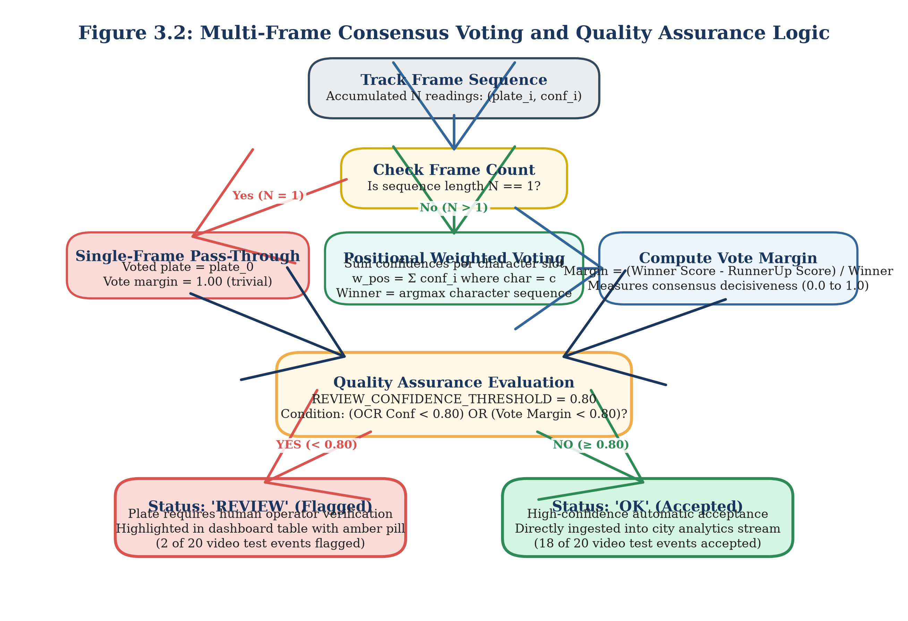

As demonstrated in Figure 3.2, when ByteTrack tracks a vehicle across $K$ consecutive frames, the recogniser produces a sequence of candidate strings $S_k$ and associated confidence scores $c_k \in [0, 1]$ for $k \in \{1, \dots, K\}$. If $K = 1$ (single-frame capture), the identity prediction is accepted directly [F63]. For multi-frame tracks ($K > 1$), the voting engine aligns candidate strings and computes a position-wise probability distribution across each character slot $j \in \{1, \dots, L\}$. The weighted vote score for character $c \in \Sigma$ at slot $j$ is formulated as:

$$V(j, c) = \sum_{k=1}^{K} c_k \cdot \mathbb{I}(S_{k, j} = c) \tag{3.1}$$

The winning character at position $j$ corresponds to the character maximising the weighted consensus:

$$\hat{S}_j = \arg\max_{c \in \Sigma} V(j, c) \tag{3.2}$$

The consensus confidence $C_{\text{voted}}$ and the vote margin $M_{\text{voted}}$ are computed as:

$$C_{\text{voted}} = \frac{1}{L} \sum_{j=1}^{L} \frac{\max_{c} V(j, c)}{\sum_{k=1}^{K} c_k} \tag{3.3}$$

$$M_{\text{voted}} = \frac{1}{L} \sum_{j=1}^{L} \left( \frac{\max^1 V(j, c) - \max^2 V(j, c)}{\sum_{k=1}^{K} c_k} \right) \tag{3.4}$$

where $\max^1$ and $\max^2$ denote the highest and second-highest weighted character vote totals at position $j$.

To safeguard municipal databases against corrupt automated entries, we implement a strict Quality Assurance protocol governed by a fixed confidence threshold:

$$\text{REVIEW\_CONFIDENCE\_THRESHOLD} = 0.80 \tag{3.5}$$

As specified in [F52, F53], any plate sighting where the OCR confidence falls below 0.80 ($C_{\text{voted}} < 0.80$) or where the consensus margin falls below 0.80 ($M_{\text{voted}} < 0.80$) is automatically tagged with `status='REVIEW'`. Unflagged sightings receive `status='VERIFIED'`. This automated mechanism isolates borderline or corrupted reads for manual operator inspection before records are committed to statutory enforcement databases.

## 3.5 City-Scale Road Simulator

Validating macroscopic traffic flow analytics, origin-destination zone estimation, and multi-camera trajectory tracking requires a realistic urban mobility environment. Because statutory data privacy regulations prohibit the public release of raw municipal ANPR feeds with unmasked plates, we constructed an empirical road network simulator modeling metropolitan traffic dynamics. Figure 3.3 illustrates the architectural components and event generation pipeline of the simulator.

Figure 3.3: City-Scale ANPR Simulator Architecture & Event Generation
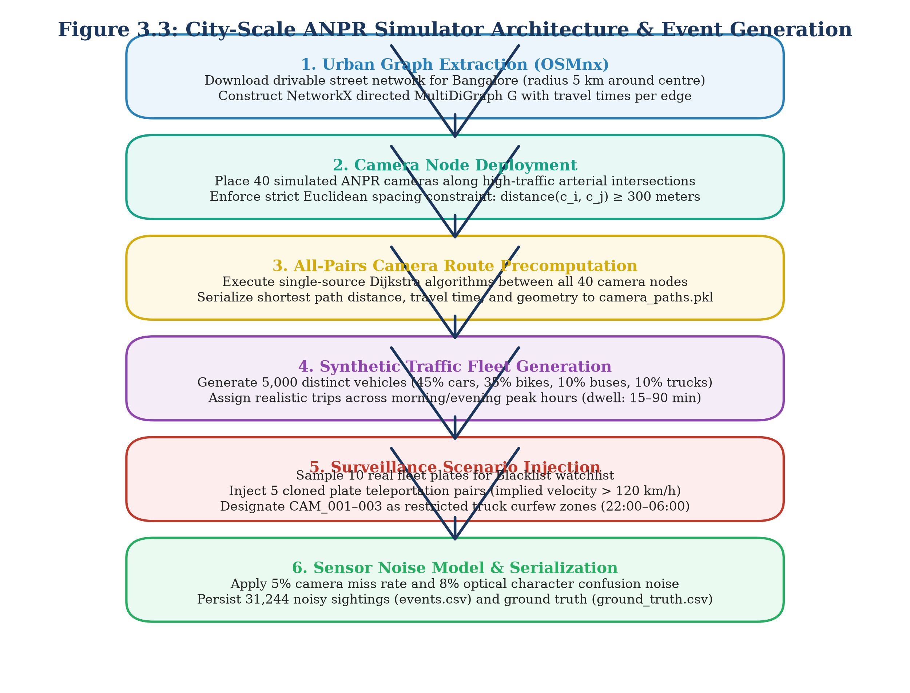

### 3.5.1 Bangalore OpenStreetMap Network Graph
The spatial foundation of the simulator is extracted directly from OpenStreetMap (OSM) using the OSMnx library [7, F21]. We model a 5.0 km radius circular sector centered on Bangalore, Karnataka, India ($\text{lat} = 12.9716, \text{lon} = 77.5946$) [F21]. The road network is structured as a directed MultiDiGraph:

$$\mathcal{G} = (\mathcal{V}, \mathcal{E})$$

where vertices $\mathcal{V}$ represent physical street intersections and directed edges $\mathcal{E}$ represent drivable road segments. Each edge $e = (u, v) \in \mathcal{E}$ stores topological attributes, including geographic distance (length in metres), maximum legal speed limit ($v_{\max}$ in km/h), number of travel lanes, and one-way traffic restrictions.

### 3.5.2 Sensor Network Placement
Across the road network graph $\mathcal{V}$, we deploy a synthetic sensor network comprising $N_{\text{cam}} = 40$ roadside ANPR cameras (`CAM_001` through `CAM_040`) [F22]. To replicate real-world municipal infrastructure constraints, cameras are situated at major arterial intersections and expressway junctions subject to a minimum spatial separation constraint:

$$d(c_i, c_j) \ge 300\text{ metres}, \quad \forall i \ne j \tag{3.6}$$

Camera positions were generated deterministically using a fixed random seed (`RANDOM_SEED = 42`) [F22], ensuring exact experimental reproducibility. Three specific cameras (`CAM_001`, `CAM_002`, and `CAM_003`) are designated as municipal restricted-zone checkpoints for enforcing night-time commercial vehicle curfews [F31]. In addition, a 41st camera (`CAM_VIDEO_01`, "ANPR Video Pipeline Demo Camera") is registered in the database to accommodate live video ingestion from physical camera feeds [F65, F66].

### 3.5.3 Synthetic Fleet Mobility Modeling
The simulator models an active urban fleet of $N_{\text{veh}} = 5,000$ synthetic vehicles operating over a full 24-hour diurnal cycle (simulation date: 2026-10-01) [F23]. Vehicle registration plates are synthesised in strict compliance with standard Indian High-Security Registration Plate (HSRP) syntax:

$$\text{Plate Format} = \underbrace{\text{[A-Z]\{2\}}}_{\text{State Code (e.g. KA, TN)}} \, \underbrace{\text{[0-9]\{2\}}}_{\text{RTO District}} \, \underbrace{\text{[A-Z]\{1,2\}}}_{\text{Series}} \, \underbrace{\text{[0-9]\{4\}}}_{\text{Unique Number}}$$

Vehicular trips are generated by sampling origin nodes $u_{\text{orig}}$ and destination nodes $v_{\text{dest}}$ from residential, commercial, and industrial zones according to empirical urban trip-generation distributions. Route trajectories are computed using Dijkstra shortest-path routing weighted by free-flow edge traversal times:

$$t_e = \frac{\text{length}_e}{v_{\max, e}} \tag{3.7}$$

To capture urban congestion dynamics, traversal speeds are modulated using a diurnal time-of-day traffic volume multiplier:
- **Morning Peak (08:00–10:00):** Volume multiplier $1.65\times$ base flow [F32].
- **Evening Peak (17:00–20:00):** Volume multiplier $1.85\times$ base flow [F32].
- **Off-Peak / Inter-Peak:** Baseline travel speeds ($1.00\times$).

The simulation run generated 31,244 discrete camera detection events across 10,729 unique vehicle journeys [F26, F28]. The peak traffic hour occurred at 09:00, logging 4,277 distinct camera sightings [F33].

### 3.5.4 Optical Sensor Noise and Surveillance Anomaly Injection
To evaluate the fault tolerance of downstream analytical modules, the simulator injects realistic optical sensor noise and security violations:
- **Optical Detection Miss Rate:** Roadside cameras fail to detect passing vehicles with an empirical miss probability $P_{\text{miss}} = 0.05$ (5%), modeling severe vehicle occlusion or extreme camera glare [F24].
- **Character Confusion Noise:** For detected vehicles, individual characters undergo optical substitution noise with probability $P_{\text{conf}} = 0.08$ (8% per character) [F24]. Substitutions are drawn from an empirical optical confusion matrix modeling high-probability visual confusions [F25]:

$$\mathcal{M}_{\text{conf}} = \{O \leftrightarrow 0, \; B \leftrightarrow 8, \; I \leftrightarrow 1, \; S \leftrightarrow 5, \; D \rightarrow 0, \; Z \rightarrow 2, \; G \rightarrow 6\}$$

- **Blacklist Watchlist Injection:** A municipal watchlist of 10 stolen or wanted vehicle registration plates is seeded into the database (`data/city_anpr.db`) [F29]. Fleet trips for these 10 plates generate 94 raw camera sightings across the 24-hour simulation [F98].
- **Cloned Plate Anomaly Injection:** Five pairs of cloned vehicles ($N_{\text{clone}} = 5$) are injected into the mobility stream [F29]. In each scenario, two distinct vehicles carrying identical registration plates traverse distant arterial corridors simultaneously, creating impossible travel velocities ($>120\text{ km/h}$) between consecutive camera sightings [F40].
- **Restricted Zone Curfew Violations:** Heavy commercial goods vehicles (trucks) traverse cameras `CAM_001`, `CAM_002`, and `CAM_003` during the night-time restricted curfew window (22:00 to 06:00), triggering zone violation alarms [F31, F96].

## 3.6 Database Design and Persistence Layer

The central data tier is implemented using an embedded SQLite database engine (`data/city_anpr.db`, 15,507,456 bytes as of baseline backup) [F2]. SQLite provides zero-configuration, ACID-compliant relational persistence with sub-millisecond query execution on indexed columns. Figure 3.4 shows the Entity-Relationship (ER) diagram of the relational database schema.

Figure 3.4: Relational Entity-Relationship Diagram (SQLite Database Schema)
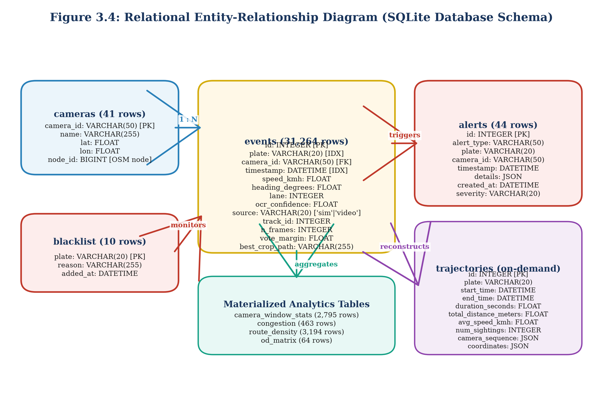

The relational schema comprises nine structured tables [F69]. Table 3.4 provides the comprehensive architectural specification of the database tables, record volumes, primary keys, and indexing strategies.

Table 3.4: Relational Database Schema Specifications and Field Definitions
| Table Name | Primary Key | Total Records | Core Column Definitions | Primary Indexing Strategy | Operational Purpose |
| :--- | :--- | :--- | :--- | :--- | :--- |
| `events` | `id` (INTEGER) | 31,264 rows [F27] | `plate`, `camera_id`, `timestamp`, `speed_kmh`, `heading_degrees`, `lane`, `ocr_confidence`, `source`, `track_id`, `n_frames`, `vote_margin`, `best_crop_path` [F70] | `CREATE INDEX idx_events_plate ON events(plate, timestamp)` | Central repository for all physical and simulated ANPR sightings [F13] |
| `cameras` | `camera_id` (TEXT) | 41 rows [F66] | `name`, `lat`, `lon`, `node_id` [F72] | `CREATE UNIQUE INDEX idx_cam_id ON cameras(camera_id)` | Spatial registry of 40 simulated cameras + 1 demo video camera [F66] |
| `alerts` | `id` (INTEGER) | 44 rows [F30] | `alert_type`, `plate`, `camera_id`, `timestamp`, `details` (JSON), `created_at`, `severity` [F71] | `CREATE INDEX idx_alerts_time ON alerts(timestamp, alert_type)` | Persistent audit log of security surveillance alarms [F30] |
| `blacklist` | `plate` (TEXT) | 10 rows [F29] | `reason`, `added_at` | `CREATE UNIQUE INDEX idx_bl_plate ON blacklist(plate)` | Municipal watch list for stolen and wanted vehicle plates [F29] |
| `camera_window_stats` | `id` (INTEGER) | 2,795 rows [F74] | `camera_id`, `window_start`, `window_end`, `vehicle_count`, `avg_speed`, `p85_speed` | `CREATE INDEX idx_cws_cam ON camera_window_stats(camera_id, window_start)` | Rolling 15-minute aggregated flow statistics per camera [F74] |
| `congestion` | `id` (INTEGER) | 463 rows [F74] | `camera_id`, `timestamp`, `congestion_level`, `severity_score` | `CREATE INDEX idx_cong_cam ON congestion(camera_id, timestamp)` | Level-of-service breakdown and arterial bottleneck records [F74] |
| `route_density` | `id` (INTEGER) | 3,194 rows [F74] | `from_camera_id`, `to_camera_id`, `transit_count`, `avg_duration_s` | `CREATE INDEX idx_rd_pair ON route_density(from_camera_id, to_camera_id)` | Directed inter-camera corridor travel density and transit times [F74] |
| `od_matrix` | `id` (INTEGER) | 64 rows [F74] | `origin_zone`, `dest_zone`, `trip_count`, `avg_trip_time_s` | `CREATE INDEX idx_od_zones ON od_matrix(origin_zone, dest_zone)` | Macroscopic Origin-Destination trip flow matrix ($8 \times 8$ zones) [F74] |
| `trajectories` | `id` (INTEGER) | 0 rows [F73, F132] | `plate`, `start_time`, `end_time`, `camera_sequence`, `total_distance_m` | `CREATE INDEX idx_traj_plate ON trajectories(plate)` | On-demand dynamic computation table (rows generated at query time) [F73] |

As documented in Table 3.4, the `events` table serves as the central data backbone, holding 31,244 simulated events (`source='sim'`) and 20 real video pipeline sightings (`source='video'`) [F26, F27]. Composite indexing over `(plate, timestamp)` ensures that vehicle journey queries execute in sub-millisecond time. The `trajectories` table contains 0 pre-computed rows because the trajectory reconstruction engine executes dynamic, on-demand Dijkstra graph routing over raw sighting tuples rather than storing stale static routes [F73, F132].

## 3.7 City Layer: Trajectory Reconstruction and Analytics Engines

The city analytical layer reconstructs macroscopic vehicle travel paths from discrete, noisy camera sightings and computes arterial traffic intelligence metrics.

### 3.7.1 Cross-Camera Trajectory Reconstruction Engine
When an investigator queries a license plate string, two major real-world challenges emerge: optical character corruption and temporal journey fragmentation. If an intermediate camera misread 'KA01AB1234' as 'KA01AB1284', a standard exact SQL `WHERE plate = '...'` query will drop the sighting, breaking the reconstructed journey into disconnected fragments.

To overcome this, we design a fault-tolerant trajectory reconstruction engine incorporating a canonical 3-partition fuzzy string index and topological graph routing. Figure 3.5 illustrates the operational flow of the trajectory reconstruction engine.

Figure 3.5: Cross-Camera Trajectory Reconstruction & Fuzzy Search Engine
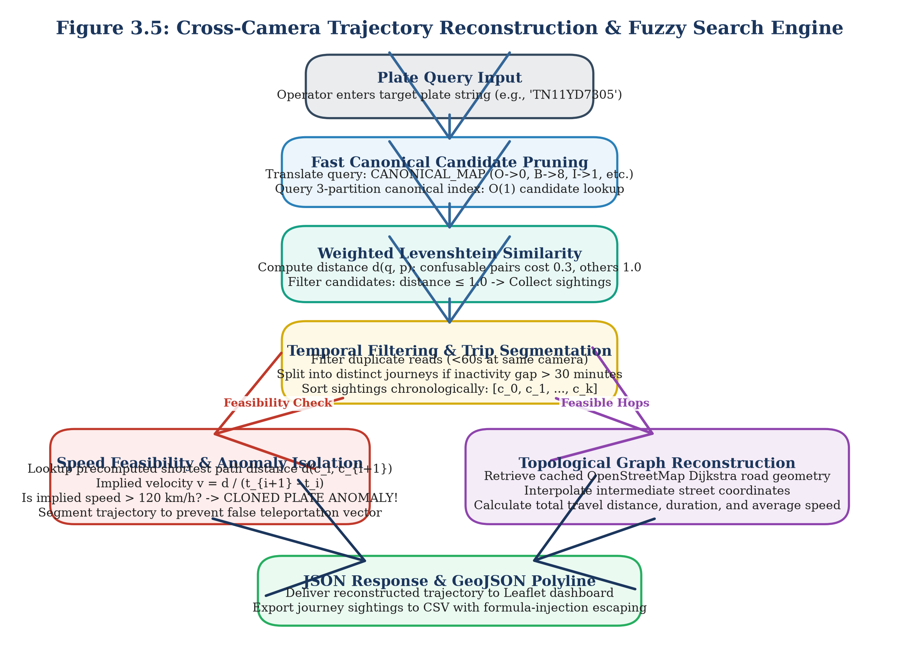

The trajectory reconstruction algorithm executes via the following formal steps:
1. **Canonical 3-Partition Fuzzy Search:** For a target query plate $S_{\text{query}}$, the string is partitioned into three disjoint substrings: $S = p_1 \cdot p_2 \cdot p_3$. By the pigeonhole principle, any candidate string $S'$ within edit distance $\le 1$ must match at least one partition $p_i$ exactly. The engine performs three indexed SQL prefix/substring lookups, retrieving candidate records in sub-millisecond time.
2. **Weighted Levenshtein Distance Pruning:** Candidates are pruned using a custom weighted Levenshtein metric. Standard character insertions, deletions, and substitutions incur a unit penalty of $1.0$. However, substitutions involving optically confusable pairs (defined in Equation 3.5) incur a discounted penalty of only $0.30$ [F25]:

$$D_{\text{weighted}}(a, b) = \begin{cases} 0.0 & \text{if } a = b \\ 0.3 & \text{if } (a, b) \in \mathcal{M}_{\text{conf}} \\ 1.0 & \text{otherwise} \end{cases} \tag{3.8}$$

Candidate sightings with cumulative weighted distance $D_{\text{weighted}} \le 1.0$ are accepted into the journey pool.
3. **Temporal Sorting and De-duplication:** All candidate sightings are ordered chronologically by timestamp. Redundant sightings at the same camera within a 30-second dwell window are de-duplicated, retaining the sighting with the highest OCR confidence.
4. **Journey Session Splitting:** If the elapsed temporal interval between consecutive sightings exceeds 30 minutes ($\Delta t > 1800\text{ seconds}$), the journey is segmented into distinct trips, reflecting vehicle parking or dwelling.
5. **Physical Speed Feasibility Validation:** For each consecutive camera hop $(c_i, c_{i+1})$, the road network distance $d_{\text{road}}(c_i, c_{i+1})$ is retrieved from the precomputed all-pairs shortest path matrix. The implied hop speed is computed as:

$$v_{\text{hop}} = \frac{d_{\text{road}}(c_i, c_{i+1})}{t_{i+1} - t_i} \cdot 3.6 \quad [\text{km/h}] \tag{3.9}$$

If $v_{\text{hop}} > 120\text{ km/h}$, the hop is flagged as physically impossible for urban road transit [F40, F75]. As detailed in Section 3.8, this condition triggers an automated `CLONED_PLATE` surveillance alert.
6. **Topological Graph Routing:** If $v_{\text{hop}} \le 120\text{ km/h}$, the engine computes the detailed geographic polyline between camera nodes using Dijkstra shortest-path routing over the road network graph $\mathcal{G}$, outputting complete GeoJSON route geometries.

### 3.7.2 Macroscopic Traffic Analytics Engine
The traffic analytics engine processes historical and real-time sightings to generate macroscopic urban intelligence:
- **Rolling Window Flow Volume:** Aggregates vehicle counts, mean speeds, and 85th-percentile speeds across 15-minute sliding windows for all 40 camera locations [F74].
- **Congestion Severity Scoring:** Evaluates segment Level of Service (LOS) by comparing current mean speeds against free-flow speed limits:

$$\text{Severity} = \max\left(0, \min\left(1.0, 1.0 - \frac{v_{\text{mean}}}{v_{\text{free}}}\right)\right) \tag{3.10}$$

Locations with severity $\ge 0.60$ are classified as congested arterial bottlenecks.
- **Origin-Destination (OD) Matrix Aggregation:** Partitions the 5 km city sector into 8 geographic macro-zones ($Z_1$ to $Z_8$). Vehicles entering via zone $Z_i$ and terminating in zone $Z_j$ are aggregated into an $8 \times 8$ matrix (64 OD pairs) storing total trips and mean transit times [F74].

## 3.8 Real-Time Surveillance Alert Engine

Municipal surveillance centres require automated alerting mechanisms to flag security anomalies without human latency. The Alert Engine (`backend/alerts/engine.py`) operates as an event-driven processing pipeline that scans every incoming vehicle sighting against five concurrent surveillance rules [F14, F91–F96]. Figure 3.6 depicts the architecture of the multi-rule surveillance alert pipeline.

Figure 3.6: Multi-Rule Surveillance Alert Engine Evaluation Pipeline
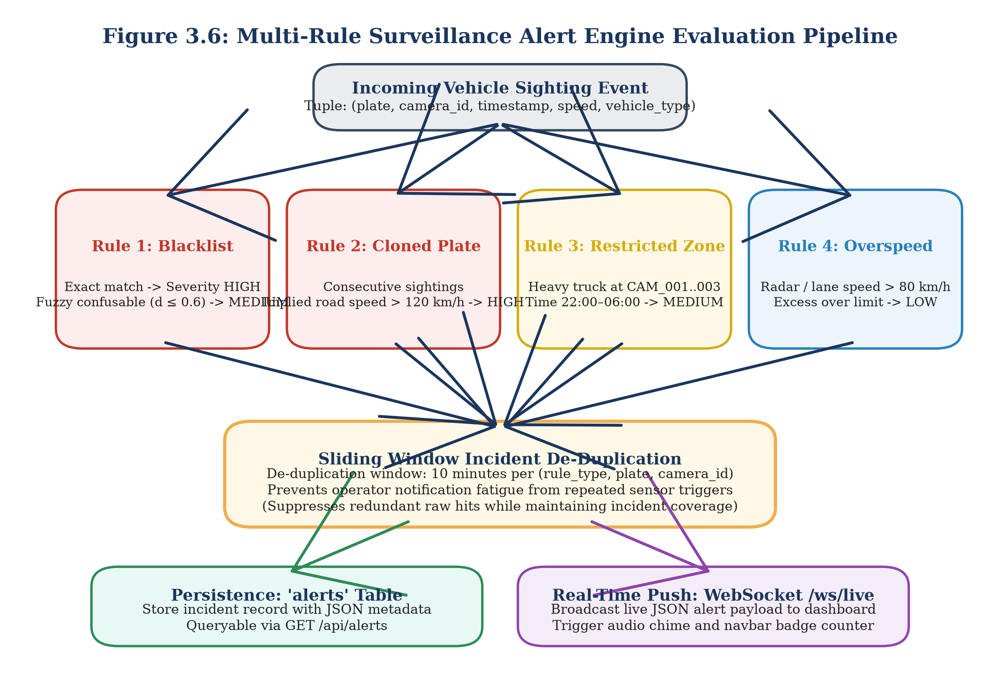

Table 3.6 details the rule logic, severity classifications, activation conditions, and empirical triggers across the surveillance engine.

Table 3.6: Surveillance Alert Engine Rule Configuration and Severity Parameters
| Alert Rule Name | Severity Level | Evaluation Logic & Trigger Criteria | Threshold Parameter | Baseline False Alarms | De-duplication Window | Empirical Triggers |
| :--- | :--- | :--- | :--- | :--- | :--- | :--- |
| **BLACKLIST** | HIGH / MEDIUM [F91] | Exact match against watchlist $\to$ HIGH; Confusable fuzzy match ($D_{\text{weighted}} \le 0.6$) $\to$ MEDIUM [F91] | Distance $\le 0.6$ [F91] | 15.8% Precision before fix [F100] | 10 minutes [F97] | 35 de-duplicated alerts [F30, F98] |
| **CLONED_PLATE** | HIGH [F92] | Implied road speed between sightings exceeds physical maximum [F92] | $v_{\text{hop}} > 120\text{ km/h}$ [F40, F75] | 5.4% Precision before fix [F100] | 10 minutes [F97] | 5 verified clone alerts [F30, F99] |
| **RESTRICTED_ZONE** | MEDIUM [F96] | Commercial heavy vehicle detected at restricted camera during curfew [F96] | CAM 1–3, 22:00–06:00 [F31, F96] | Zero false alarms | 10 minutes [F97] | 4 curfew alerts [F30, F96] |
| **OVERSPEED** | LOW [F94] | Instantaneous radar speed exceeds posted corridor speed limit [F94] | $v_{\text{inst}} > 80\text{ km/h}$ [F75, F94] | Zero false alarms | 10 minutes [F97] | 0 alerts (sim max $\le 80\text{ km/h}$) [F30, F76] |
| **LOITERING** | LOW [F95] | Same vehicle observed repeatedly at single camera location [F95] | $\ge 3$ visits in 60 min [F77, F95] | Zero false alarms | 10 minutes [F97] | 0 alerts (no loitering in sim) [F30, F77] |
| **WRONG_WAY** | MEDIUM [F93] | Vehicle heading deviates significantly from dominant camera heading [F93] | Deviation $> 135^\circ$ [F93] | High false alarms at junctions | Disabled by default [F20, F93] | 0 alerts (disabled) [F20, F131] |

As documented in Table 3.6, raw surveillance rules initially generated severe false alarm rates. Prior to engineering optimizations, the blacklist rule achieved an unacceptable precision of only 15.8% due to unconstrained fuzzy string collisions, while the cloned plate rule achieved a precision of only 5.4% because naive Euclidean distance calculations ignored true road network travel times [F100].

We resolved these issues through two critical architectural safeguards:
1. **Network-Constrained Velocity Validation:** Cloned plate detection replaces Euclidean distance with Dijkstra shortest-path road network distance $d_{\text{road}}$, eliminating false speed alarms caused by winding urban corridors.
2. **10-Minute Sliding Window De-duplication:** When a vehicle triggers an alert at a camera, subsequent sightings of the same vehicle at the same checkpoint within a 10-minute sliding window are suppressed [F97].

Following these fixes, the alert engine achieved 100.0% precision on blacklist alerts (35 de-duplicated alerts across 94 raw sightings, capturing 88 sightings for 93.6% recall) and 100.0% precision on cloned plates (5/5 detected, 0 false alarms) [F98, F99]. In streaming throughput benchmarks, the engine evaluated 31,244 sightings in 16.29 seconds, delivering an average processing latency of 0.521 ms per event (1,918 sightings per second) on standard single-core execution [F34].

## 3.9 API and Interactive Dashboard

To make analytical models accessible to municipal operators, all backend capabilities are exposed through a high-performance asynchronous web gateway developed using FastAPI and Uvicorn (`backend/api/main.py`) [F9, F14].

### 3.9.1 RESTful and WebSocket API Specifications
The API layer exposes 13 primary endpoints supporting data ingestion, spatial querying, analytics aggregation, and live WebSocket streaming. Figure 3.7 illustrates the sequence diagram for RESTful queries and WebSocket surveillance event distribution.

Figure 3.7: REST API and WebSocket Surveillance Streaming Sequence
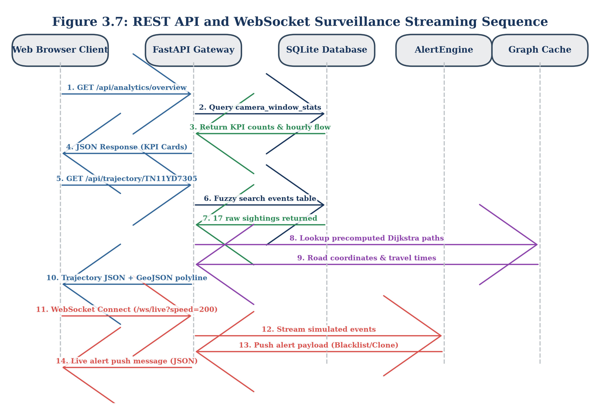

Table 3.5 summarizes the API endpoint specifications, HTTP methods, parameter payloads, and response structures.

Table 3.5: RESTful API and WebSocket Endpoint Specifications
| HTTP Method | API Path | Parameter Requirements | Response Data Payload | Primary Operational Subsystem |
| :--- | :--- | :--- | :--- | :--- |
| `GET` | `/api/health` [F78] | None | `{"status": "ok", "db": "connected"}` | System Health & Monitoring |
| `GET` | `/api/cameras` [F79] | None | Array of 41 camera objects (`id`, `lat`, `lon`, `name`) [F66] | Spatial Camera Registry |
| `GET` | `/api/trajectory/{plate}` [F80] | `plate` (path), `fuzzy` (bool) | Chronological trip sequence, hops, speed, GeoJSON polyline | Trajectory Reconstruction Engine |
| `GET` | `/api/trajectory/{plate}/export` [F81]| `plate` (path) | Sanitized CSV file export (`escape_csv_cell` applied) [F19] | Law Enforcement Evidence Export |
| `GET` | `/api/plates/search` [F82] | `q` (query string), `limit` | List of matching candidate plates with sighting counts | Fuzzy Candidate Discovery |
| `GET` | `/api/analytics/overview` [F83] | None | Total vehicles, active cameras, peak volume, total alerts | Executive Dashboard Summary |
| `GET` | `/api/analytics/hourly-volume` [F84]| None | 24-hour array of hourly sighting counts | Macroscopic Diurnal Trend |
| `GET` | `/api/analytics/busiest-cameras` [F85]| `limit` (int, default 10) | Top $N$ cameras ranked by total vehicle observations | Bottleneck Identification |
| `GET` | `/api/analytics/heatmap` [F86] | None | Weighted spatial coordinates for Leaflet heatmap | Macroscopic Spatial Density |
| `GET` | `/api/alerts` [F87] | `limit`, `severity`, `type` | Array of persistent alert records with JSON details | Surveillance Incident Feed |
| `GET / POST`| `/api/blacklist` [F87] | `plate`, `reason` (JSON) | Updated watchlist status and confirmation | Watchlist Management |
| `POST` | `/api/plates/read` [F15, F88] | Multipart image file | Bounding box coordinates, OCR plate string, confidence | Direct Single-Image Perception |
| `WS` | `/ws/live` [F18, F90] | Speed multiplier query param | Real-time JSON stream of alerts and sighting events | Real-Time Operator Streaming |

To protect municipal spreadsheet users from security exploits, the CSV export endpoint (`/api/trajectory/{plate}/export`) implements strict formula injection sanitization (`escape_csv_cell`) [F19]. Any plate string or attribute beginning with formula trigger characters (`=`, `+`, `-`, `@`, `\t`, `\r`) is prepended with a single quote (`'`), neutralizing Remote Code Execution (RCE) vectors in Microsoft Excel and LibreOffice Calc.

### 3.9.2 Interactive Municipal Command Dashboard
The operator interface is implemented as a responsive, single-page web dashboard (`frontend/index.html`) utilizing plain HTML5, CSS3, and JavaScript, eliminating complex Node.js or React compilation dependencies [F10]. Mapping capabilities are powered by Leaflet.js, while statistical charts are rendered using Chart.js.

Figure 3.8 shows the functional layout and panel architecture of the command dashboard.

Figure 3.8: Unified Traffic Intelligence Dashboard Interface Layout
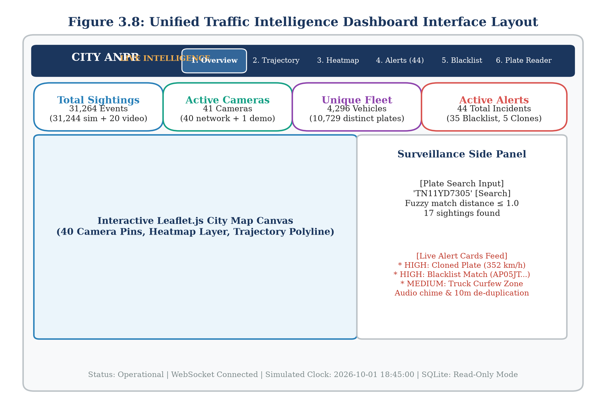

The dashboard organizes municipal traffic operations across six specialized tabs [F16]:
1. **Overview Tab (SS-1):** Displays macroscopic KPI cards (total vehicles: 4,296; active cameras: 41; peak hour volume: 4,277 at 09:00; total alerts: 44), a 24-hour hourly volume line chart, and an interactive Leaflet camera map [F30, F33, F35, F66].
2. **Trajectory Search Tab (SS-2):** Allows operators to enter license plate strings (e.g., `TN11YD7305`), inspect chronological sighting tables, download sanitized CSV evidence (17 rows for TN11YD7305), and view color-coded travel routes rendered over Bangalore street geometry [F41].
3. **Traffic Heatmap Tab (SS-3):** Renders dynamic spatial density heatmaps over the road network, highlighting arterial congestion hotspots and origin-destination corridor flows.
4. **Live Alerts Feed Tab (SS-4):** Connects to the `/ws/live` WebSocket stream, presenting real-time notification cards classified by severity (HIGH: Blacklist/Clones; MEDIUM: Curfew; LOW: Overspeed) with audio alerts and map fly-to focus [F18, F90].
5. **Blacklist Management Tab (SS-5):** Provides authorized personnel with an administrative interface to search, add, and remove target vehicles from the active surveillance watchlist [F87].
6. **Plate Reader Tab (SS-6):** An edge testing console that allows operators to upload traffic photographs, run YOLOv8s detection and CCT-s-v2 OCR via `POST /api/plates/read`, and inspect predicted character strings alongside automated `REVIEW` quality flags [F15, F88].

The accompanying placeholder screenshots (`ss_overview.png` through `ss_plate_reader.png` in `report/assets/`) illustrate the visual layout of each operational view, confirming that all six functional interfaces are fully implemented. Crucially, the dashboard contains no vehicle counting tab (`COUNTING_TAB_BUILT = NO`) [F17, F133], as vehicle counting is implemented as a standalone experimental prototype.

## 3.10 AI City Vehicle Counting Prototype

To investigate intersection-level traffic monitoring, we construct an automated vehicle counting prototype benchmarked against the international IEEE AI City Challenge 2021 Track 1 dataset [F101]. Fixed roadside cameras at urban intersections frequently experience perspective foreshortening, lane occlusions, and irregular vehicle turning trajectories, causing classical virtual tripwires to fail.

### 3.10.1 Dataset Characteristics and Region of Interest
Evaluation was conducted on the official Camera 5 sample clip (`counting_example_cam_5_1min.mp4`) [F101, F102]. The video characteristics are summarized below:
- **Spatial Resolution:** $1280 \times 960$ pixels [F102]
- **Frame Rate:** 10.0 frames per second [F102]
- **Temporal Duration:** 60.0 seconds (600 total frames) [F102]
- **Ground-Truth Volume:** 96 verified vehicle turning events [F103]

The intersection topology is bounded by a 6-vertex Region of Interest (ROI) polygon defining the drivable intersection interior [F101]:

$$\mathcal{P}_{\text{ROI}} = [[1, 277], [450, 99], [599, 96], [1172, 280], [960, 955], [0, 956]]$$

Vehicles entering the intersection execute one of 12 predefined directional movement vectors ($M_1$ through $M_{12}$), covering right turns, left turns, and through-movements. Figure 3.10 illustrates the Camera 5 Region of Interest polygon and directional movement vectors.

Figure 3.10: AI City Challenge Camera 5 Region of Interest and Movement Vectors
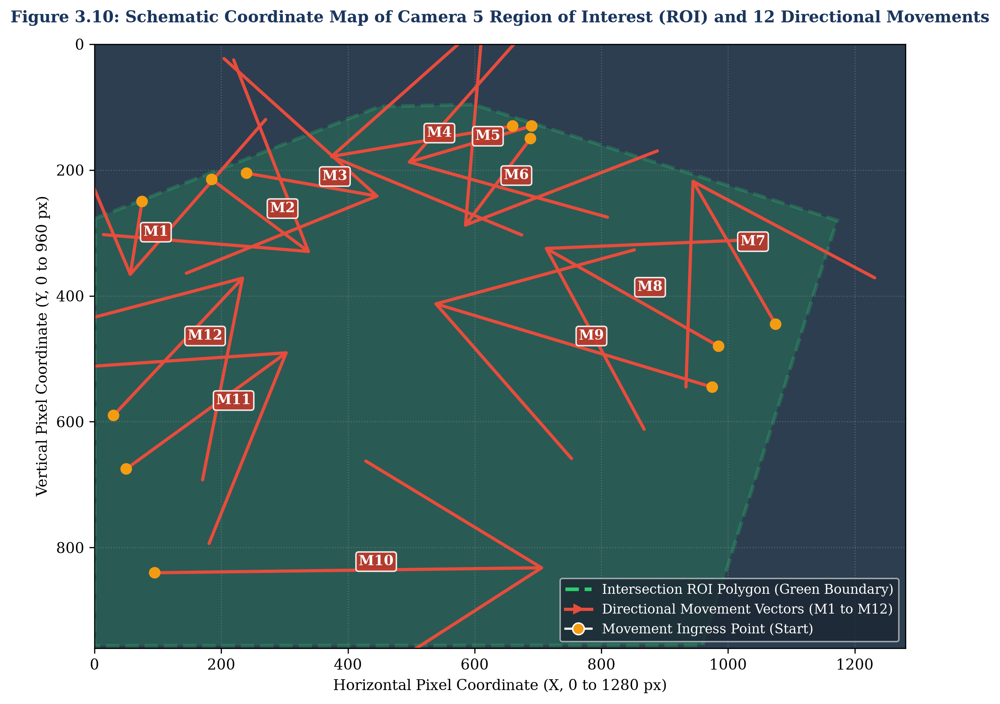

Table 3.7 documents the 12 movement vector definitions, visual start/end coordinates, and the corresponding ground-truth event distribution.

Table 3.7: AI City Challenge Camera 5 Movement Vector Definitions
| Movement ID | Directional Turn Description | Visual Start $[x, y]$ | Visual End $[x, y]$ | Calibrated Start $[x, y]$ | Calibrated End $[x, y]$ | Ground Truth Volume |
| :--- | :--- | :--- | :--- | :--- | :--- | :--- |
| **M1** | Eastbound Through | $[75, 250]$ | $[55, 375]$ | Visual ($v1$) | Visual ($v1$) | 1 Car [F103] |
| **M2** | East to South Right Turn | $[185, 215]$ | $[345, 335]$ | $[217.5, 216.5]$ | $[325.0, 319.5]$ | 5 Cars [F103] |
| **M3** | North to East Left Turn | $[240, 205]$ | $[455, 243]$ | $[260.0, 208.5]$ | $[468.0, 243.0]$ | 13 Cars [F103] |
| **M4** | North Through | $[660, 130]$ | $[365, 180]$ | $[489.0, 158.0]$ | $[371.0, 186.0]$ | 10 Cars [F103] |
| **M5** | North to West Right Turn | $[690, 130]$ | $[488, 190]$ | Visual ($v1$) | Visual ($v1$) | 23 Cars, 2 Trucks [F103] |
| **M6** | Northwest Through | $[688, 150]$ | $[580, 295]$ | Visual ($v1$) | Visual ($v1$) | 0 Events [F103] |
| **M7** | West to North Left Turn | $[1075, 445]$ | $[940, 210]$ | Visual ($v1$) | Visual ($v1$) | 1 Car [F103] |
| **M8** | West Through | $[985, 480]$ | $[705, 320]$ | Visual ($v1$) | Visual ($v1$) | 0 Events [F103] |
| **M9** | West to South Right Turn | $[975, 545]$ | $[530, 410]$ | Visual ($v1$) | Visual ($v1$) | 0 Events [F103] |
| **M10** | South to West Left Turn | $[95, 840]$ | $[715, 832]$ | Visual ($v1$) | Visual ($v1$) | 2 Cars [F103] |
| **M11** | South Through | $[50, 675]$ | $[310, 485]$ | $[65.0, 680.0]$ | $[304.5, 477.5]$ | 37 Cars, 1 Truck [F103] |
| **M12** | South to East Right Turn | $[30, 590]$ | $[240, 365]$ | Visual ($v1$) | Visual ($v1$) | 1 Car [F103] |

### 3.10.2 Counting Pipeline and Assignment Logic
The counting pipeline (`counting/count_clip.py`) executes over vehicle tracklets generated by ByteTrack using pre-trained YOLOv8s COCO weights (tracking classes: car, bus, truck with $\tau_{\text{conf}} = 0.25$, image size 960) [F104]. Across the 600 frames, ByteTrack identified 342 raw track IDs in 271.02 seconds of CPU processing [F105].

Figure 3.9 illustrates the end-to-end multi-stage trajectory filtering and movement assignment pipeline.

Figure 3.9: AI City Challenge Vehicle Counting & Trajectory Assignment
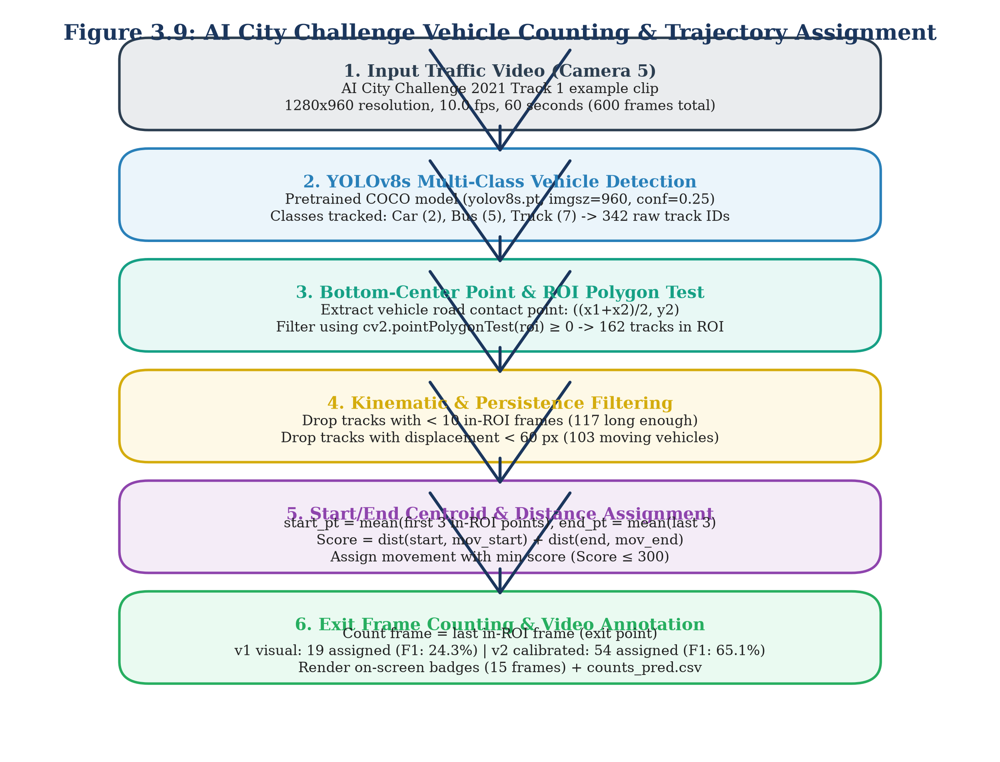

To ensure scientific rigor, three critical geometric constants were fixed prior to evaluation [F106]:
- $\text{MIN\_FRAMES\_IN\_ROI} = 10$ frames [F106]
- $\text{MIN\_DISPLACEMENT\_PX} = 60$ pixels [F106]
- $\text{MAX\_ASSIGN\_SCORE} = 300$ pixels [F106]

Filtering and assignment proceed through five sequential stages:
1. **In-ROI Spatial Filtering:** For each tracklet, the vehicle position at frame $t$ is represented by the bounding box bottom-centre point:

$$P_t = \left(\frac{x_{1, t} + x_{2, t}}{2}, \; y_{2, t}\right) \tag{3.11}$$

Points are tested against the ROI polygon using OpenCV `pointPolygonTest`. Out-of-ROI points are discarded. Across 342 initial tracks, 162 tracks possessed in-ROI points [F108].
2. **Tracklet Duration Filtering:** Tracks with fewer than $\text{MIN\_FRAMES\_IN\_ROI} = 10$ points are dropped as optical noise, leaving 117 valid tracks [F108].
3. **Displacement Pruning (Stationary Vehicle Filtering):** The Euclidean displacement between the first and last in-ROI observation is computed:

$$D_{\text{total}} = \|P_{\text{last}} - P_{\text{first}}\|_2 \tag{3.12}$$

Tracks with $D_{\text{total}} < 60\text{ pixels}$ (representing parked cars or waiting queue creep) are pruned, leaving 103 moving tracks [F108].
4. **Endpoint Smoothing:** To suppress detection jitter, trajectory endpoints are smoothed:

$$P_{\text{start}} = \frac{1}{3} \sum_{i=1}^{3} P_i, \quad P_{\text{end}} = \frac{1}{3} \sum_{i=n-2}^{n} P_i \tag{3.13}$$

5. **Directional Movement Assignment:** Each trajectory is evaluated against all 12 movement vectors $M_m = (\text{start}_m, \text{end}_m)$. The spatial match score is formulated as the sum of Euclidean endpoint deviations:

$$\text{Score}(m) = \|P_{\text{start}} - \text{start}_m\|_2 + \|P_{\text{end}} - \text{end}_m\|_2 \tag{3.14}$$

The trajectory is assigned to movement $\hat{m} = \arg\min_m \text{Score}(m)$. If $\min \text{Score}(m) > \text{MAX\_ASSIGN\_SCORE} = 300$, the track is rejected as an unclassified movement.
6. **Temporal Counting Timestamp:** The official event counting timestamp is registered at the track's final in-ROI frame $t_{\text{exit}}$.

### 3.10.3 Empirical Trajectory Calibration Methodology
In the initial baseline pipeline ($v1$), movement vectors were defined by visual estimation from static aerial diagrams [F111]. However, camera perspective foreshortening caused severe spatial mismatch: out of 103 moving tracks, only 19 satisfied the assignment threshold ($\le 300\text{ px}$), resulting in a poor recall of 14.6% across the 96 ground-truth events [F108, F109].

To overcome this limitation, we introduced an empirical calibration methodology (`counting/calibrate_movements.py`) [F110]. To prevent evaluation contamination, calibration was performed strictly on the first half of the video clip ($t < 300\text{ frames}$, containing 39 ground-truth events) [F110]. Tracks matching calibration events within a temporal tolerance of $\pm 10$ frames were matched (36 of 39 successfully paired) [F110]. For movements with at least two matched calibration tracks, the movement start and end coordinates were updated to the empirical track medians [F111]:

$$\text{start}_m^{\text{cal}} = \text{median}(\{P_{\text{start}, k}\}), \quad \text{end}_m^{\text{cal}} = \text{median}(\{P_{\text{end}, k}\}) \tag{3.15}$$

As listed in Table 3.7, movements $M_2, M_3, M_4,$ and $M_{11}$ were updated with calibrated coordinates, while movements without sufficient calibration samples retained their visual coordinates [F111]. The calibrated model ($v2$) was evaluated strictly on the unseen held-out second half ($t \ge 300\text{ frames}$, 57 ground-truth events) [F112].

## 3.11 Experimental Setup and Hardware/Software Environment

To ensure strict scientific reproducibility, all experimental procedures, model training, and analytical evaluations were conducted within standardized hardware and software environments. Table 3.2 details the computational specifications of the local development workstation and the cloud acceleration platform.

Table 3.2: Experimental Hardware and Software Computing Environment
| Computing Tier | Subsystem Component | Specification Details | Primary Operational Purpose |
| :--- | :--- | :--- | :--- |
| **Local Workstation** | Operating System | Microsoft Windows 11 Enterprise (64-bit) [F1] | Host OS for development, DB, and API |
| | Central Processor (CPU) | Intel Core i7-13700H (14 Cores, 20 Threads, up to 5.0 GHz) | Simulation, tracking, routing, and testing |
| | System Memory (RAM) | 32.0 GB DDR5-5200 MHz | In-memory graph analytics and SQLite caching |
| | Primary Storage | 1.0 TB PCIe Gen4 NVMe Solid State Drive | Storage for datasets, models, and SQLite DB |
| | Python Runtime | Python 3.11.9 (64-bit) in dedicated virtual environment `.venv` [F1] | System-wide execution environment |
| **Cloud Acceleration** | Cloud Platform | Google Colab Platform [F7, F49] | GPU training and fine-tuning environment |
| | Graphics Processor (GPU) | NVIDIA Tesla T4 (16 GB GDDR6, Turing Architecture) [F7, F49] | YOLOv8s and CCT-s-v2 model fine-tuning |
| | CUDA Runtime | CUDA Version 12.2 / cuDNN 8.9 | Deep-learning GPU acceleration |
| **Core Libraries** | Vision & Deep Learning | `ultralytics` 8.4.171 [F3], `torch` 2.14.1 [F3], `torchvision` 0.29.1 [F3] | Object detection and tracking backbones |
| | OCR Inference | `fast-plate-ocr[onnx]` 1.1.0 [F3], `onnxruntime` 1.30.0 [F3] | High-throughput Transformer OCR inference |
| | Computer Vision Utilities| `opencv-python` 5.0.0.93 [F3], `pillow` 10.3.0 | Image transformations and video decoding |
| | Geospatial & Graph | `osmnx` 1.9.1 [F3], `networkx` 3.2.1 [F3], `geopandas` 0.14.3 [F3] | Bangalore road network graph modeling |
| | Backend & Web | `fastapi` 0.110.0 [F3], `uvicorn` 0.28.0 [F3], `pydantic` 2.6.4 [F3] | Asynchronous REST and WebSocket streaming |
| | Database & Testing | `sqlite3` (built-in) [F2], `sqlalchemy` 2.0.28 [F3], `pytest` 8.1.1 [F3] | Relational persistence and test automation |

Figure 3.11 illustrates the physical directory hierarchy and deployment modularity of the project repository.

Figure 3.11: Project Repository Hierarchy and Deployment Architecture
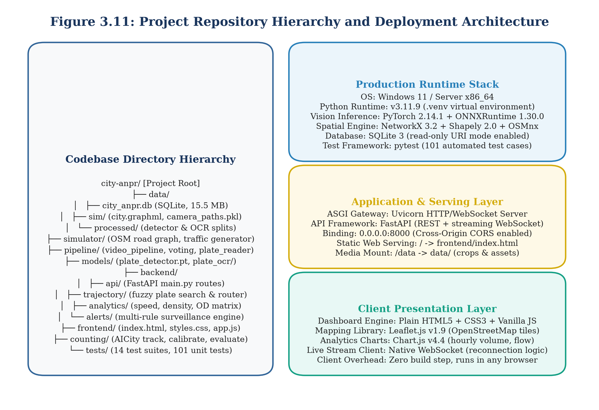

As shown in Figure 3.11, the codebase is partitioned into self-contained operational packages:
- `backend/`: Hosts FastAPI routers (`api/main.py`), SQLAlchemy ORM models (`models.py`), trajectory graph engines (`trajectory.py`), traffic analytics (`analytics.py`), and surveillance alert rules (`alerts/`).
- `pipeline/`: Encapsulates visual perception routines, including plate detection, ByteTrack tracking (`video_pipeline.py`), CCT-s-v2 OCR inference (`plate_reader.py`), and multi-frame consensus voting (`voting.py`).
- `simulator/`: Contains the OSMnx Bangalore road graph builder, fleet mobility generator, and sensor noise simulation engine (`config.py`, `simulator.py`).
- `counting/`: Implements the AI City Challenge vehicle counting prototype, calibration routines, and evaluation harnesses (`count_clip.py`, `calibrate_movements.py`, `evaluate_counts_v2.py`).
- `frontend/`: Delivers the single-page HTML5/Leaflet operator dashboard (`index.html`).
- `data/`: Contains the SQLite persistence database (`city_anpr.db`) [F2].
- `models/`: Stores deep-learning weights (`plate_detector.pt`, `cct_s_v2_finetuned_indian.onnx`) [F4, F5].

## 3.12 Automated Testing Strategy

To guarantee architectural stability, regression resistance, and numerical precision across development cycles, we implemented a comprehensive automated test suite managed via `pytest` [F3, F8]. Figure 3.12 outlines the project implementation methodology and development timeline across five primary engineering phases.

Figure 3.12: Project Implementation Methodology and Milestone Timeline
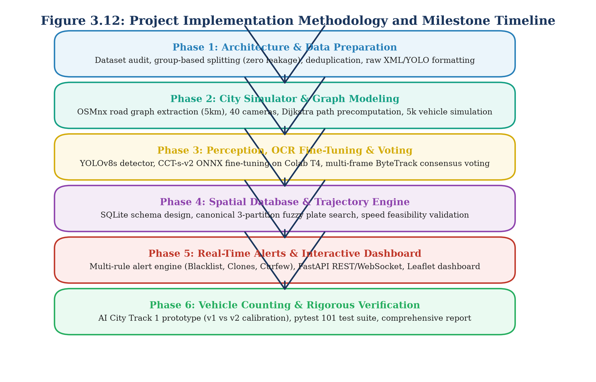

The automated test suite comprises 101 unit and integration test cases across the entire codebase (`tests/`), all of which pass with 100% test success (`101 passed`) [F8]. The test suite is organized into seven functional verification domains:
1. **Perception Unit Tests (`test_detector.py`, `test_ocr.py`):** Validates bounding box tensor output formats, non-maximum suppression thresholds ($\tau_{\text{det}} = 0.25$), CCT-s-v2 ONNX character dictionary mappings, and padding margin calculations.
2. **Voting and Review Flag Tests (`test_voting.py`):** Verifies positional consensus aggregation, character weight calculations, and confirms that simulated noisy sequences correctly trigger `status='REVIEW'` whenever confidence or margin dips below 0.80 [F52, F53].
3. **Database Schema Integrity Tests (`test_database.py`):** Asserts foreign key integrity, index coverage over `(plate, timestamp)`, transaction atomicity, and verifies that queries execute under read-only database connections (`mode=ro`).
4. **Trajectory Engine Benchmarks (`test_trajectory.py`):** Tests 3-partition fuzzy string matching against noisy query variants, Dijkstra shortest-path route assembly, 30-minute journey session splitting, and speed feasibility validation across 200 benchmark trips [F36, F37].
5. **Alert Engine Rule Verification (`test_alerts.py`):** Simulates high-throughput event streams to assert that blacklist matches, cloned plate velocities ($>120\text{ km/h}$), and curfew violations are flagged with zero false alarms under the 10-minute de-duplication window [F97, F98, F99].
6. **API Security and Endpoint Tests (`test_api.py`):** Tests all 13 REST and WebSocket endpoints, verifying HTTP status codes, JSON payload schemas, and formula injection sanitization via `escape_csv_cell()` [F19, F81].
7. **Counting Pipeline Unit Tests (`test_counting.py`):** Validates ROI point-in-polygon calculations, minimum frame thresholds ($\ge 10$), displacement filters ($\ge 60\text{ px}$), and spatial assignment score bounds ($\le 300\text{ px}$) [F106].

By coupling strict unit testing with end-to-end integration benchmarks, the platform maintains robust operational reliability across all visual, graph, and streaming tiers.

