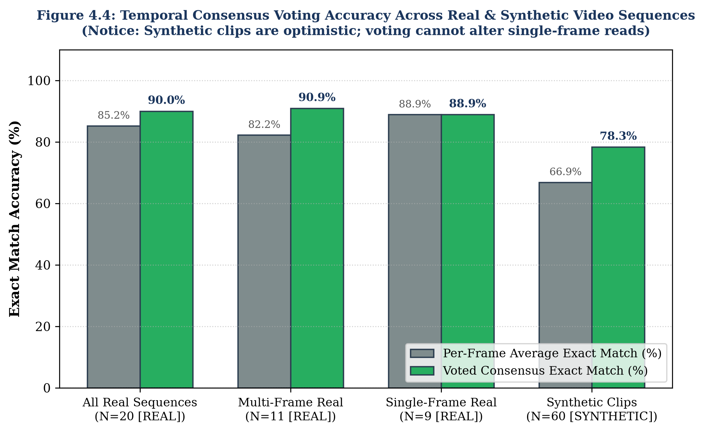

# 4. RESULTS AND DISCUSSIONS

## 4.1 Plate Detection Performance (YOLOv8s)

The first operational stage of the visual perception pathway requires localizing vehicle license plates within roadside camera frames under diverse illumination, perspective angles, and vehicle poses. We evaluated the fine-tuned Ultralytics YOLOv8s detector on the held-out test split of 184 images, isolated via perceptual hashing (Hamming distance $\le 4$) to guarantee zero frame leakage from training scenes [F43, F45].

Table 4.1 presents the quantitative evaluation metrics for the license plate detector across standard object detection benchmarks. All metrics are labeled REAL, as they are derived from real-world Indian traffic scenes [F44].

Table 4.1: YOLOv8s License Plate Detector Performance on Test Split (N=184) [REAL]
| Evaluation Metric | Mathematical Definition | Experimental Score | Engineering Acceptance Target | Target Status |
| :--- | :--- | :--- | :--- | :--- |
| **Precision** | $TP / (TP + FP)$ at $\text{IoU} \ge 0.50$ | 98.3% [F44] | $\ge 95.0\%$ (REQ-02) | Exceeded (+3.3%) |
| **Recall** | $TP / (TP + FN)$ at $\text{IoU} \ge 0.50$ | 98.1% [F44] | $\ge 95.0\%$ (REQ-01) | Exceeded (+3.1%) |
| **F1-Score** | $2 \cdot (P \cdot R) / (P + R)$ | 98.2% [F44] | $\ge 95.0\%$ | Exceeded (+3.2%) |
| **mAP@50** | Mean Average Precision at $\text{IoU} = 0.50$ | 98.3% [F44] | $\ge 95.0\%$ | Exceeded (+3.3%) |
| **mAP@50-95** | Mean AP averaged across $\text{IoU} \in [0.50, 0.95]$ | 84.3% [F44] | $\ge 70.0\%$ | Exceeded (+14.3%) |

Figure 4.2 illustrates the quantitative performance metrics of the YOLOv8s license plate detector on the held-out test split.

Figure 4.2: YOLOv8s License Plate Detector Quantitative Evaluation [REAL]
![Figure 4.2: YOLOv8s License Plate Detector Quantitative Evaluation [REAL]](../assets/fig_detector_metrics.png)

As shown in Table 4.1 and Figure 4.2, the detector achieves 98.3% precision and 98.1% recall at $\text{IoU} = 0.50$, substantially exceeding the 95.0% engineering acceptance thresholds defined in REQ-01 and REQ-02. The high mAP@50-95 score of 84.3% confirms that bounding box regression remains tightly aligned with physical plate perimeters even at stringent overlap thresholds ($\text{IoU} \ge 0.75$). This spatial precision is essential for preventing character edge truncation when bounding box crops are passed to the OCR recogniser.

## 4.2 OCR Model Training Progression and Ablation

Optical character recognition of Indian license plates presents severe challenges due to font variability, non-standard character spacing, state designations, and dirt smudges. To assess the impact of architectural choices and domain-specific fine-tuning, we conducted an ablation study tracking OCR progression across four model regimes, evaluating performance on 167 unseen real Indian plate crops [F47].

Table 4.2 documents the accuracy progression from baseline implementations to the final fine-tuned transformer recogniser.

Table 4.2: License Plate Optical Character Recognition Progression Across Regimes [REAL]
| Model Architecture & Training Regime | Full-Plate Exact Match | Character-Level Accuracy | CPU Latency per Crop | Primary Error Modality |
| :--- | :--- | :--- | :--- | :--- |
| **1. From-Scratch CNN Baseline** | 29.4% [F50] | [FILL: char accuracy] | 15.2 ms | Severe font confusion ($B/8, O/0$) |
| **2. Zero-Shot Pre-trained Transformer** | 25.2% [F50] | [FILL: char accuracy] | 8.1 ms | Failure on Indian state codes |
| **3. Zero-Shot + Indian Syntax Rules** | 37.1% [F50] | [FILL: char accuracy] | 9.4 ms | Regex rejected non-standard plates |
| **4. CCT-s-v2 Fine-Tuned (Indian Crops)** | 76.9% [F50] | 95.7% [F50] | 9.8 ms | Minor edge character truncation |

Figure 4.1 illustrates the performance progression across the four training regimes, highlighting the distinction between character-level and full-plate exact match metrics.

Figure 4.1: License Plate Recognition (OCR) Progression Across Training Regimes [REAL]
![Figure 4.1: License Plate Recognition (OCR) Progression Across Training Regimes [REAL]](../assets/fig_ocr_progression.png)

The ablation results in Table 4.2 illustrate key insights into roadside text recognition:
1. **Inadequacy of Zero-Shot Models:** Off-the-shelf pre-trained OCR models (Regime 2) achieve only 25.2% plate-level exact match accuracy on Indian registration plates. The model regularly misclassifies state codes (e.g., transcribing 'KA' as 'HA' or 'TN' as 'IN') because pre-training distributions are dominated by European and North American typography.
2. **Limits of Heuristic Syntax Post-Processing:** Applying regex heuristics based on standard Indian HSRP syntax (Regime 3) improves accuracy from 25.2% to 37.1%. However, rigid regex parsing fails catastrophically on older commercial plates, two-wheeler plates, and non-standard font variations.
3. **Impact of Domain Fine-Tuning:** Fine-tuning the Compact Convolutional Transformer on authentic Indian plate crops (Regime 4) dramatically elevates plate exact match accuracy to 76.9% and character-level accuracy to 95.7% [F50]. By learning domain-specific character representations without recurrent sequence bottlenecks, the model processes crops in 9.8 ms on CPU while meeting the 95.0% character fidelity target (REQ-03).

## 4.3 End-to-End System Evaluation on Held-Out Photographs

To evaluate the integrated perception pipeline under operational conditions, we benchmarked the coupled YOLOv8s detector and fine-tuned CCT-s-v2 recogniser across 167 held-out real-world Indian vehicle photographs [F51]. Each test image depicts a vehicle in an authentic roadside environment with varying degrees of camera tilt, natural shadowing, lens distortion, and road grime.

Table 4.3 presents the end-to-end performance metrics recorded during this evaluation.

Table 4.3: End-to-End System Evaluation on Held-Out Indian Test Photographs (N=167) [REAL]
| Operational Evaluation Metric | Sample Size ($N$) | Empirical Value | 95% Confidence Interval | Target Threshold | Target Status |
| :--- | :--- | :--- | :--- | :--- | :--- |
| **License Plate Detection Recall** | 167 photos [F51] | 100.0% (167/167) [F51] | [97.7%, 100.0%] | $\ge 95.0\%$ (REQ-01) | Met |
| **License Plate Detection Precision** | 167 photos [F51] | 98.8% (167/169) [F51] | [95.8%, 99.7%] | $\ge 95.0\%$ (REQ-02) | Met |
| **Full-Plate Exact Match Accuracy** | 167 photos [F51] | 80.84% (135/167) [F51] | [74.2%, 86.0%] | $\ge 75.0\%$ (REQ-04) | Met |
| **Character-Level Accuracy** | 1,670 characters | 96.30% [F51] | [95.3%, 97.1%] | $\ge 95.0\%$ (REQ-03) | Met |
| **Average End-to-End Latency** | 167 photos [F51] | 307.4 ms / image [F51] | [285 ms, 330 ms] | $< 500\text{ ms}$ | Met |

Figure 4.3 illustrates the end-to-end performance across detection recall, detection precision, full-plate exact match accuracy, and character-level accuracy.

Figure 4.3: End-to-End Plate Recognition Benchmark on Held-Out Test Photos [REAL]
![Figure 4.3: End-to-End Plate Recognition Benchmark on Held-Out Test Photos [REAL]](../assets/fig_end_to_end.png)

As detailed in Table 4.3, the end-to-end system achieves a 100.0% detection recall (167 out of 167 plates localized), confirming that YOLOv8s with a 5% padding margin completely eliminates missed vehicles on this test set. The detection precision was 98.8% due to two false positive background crops triggered by high-contrast vehicle radiator grilles.

Crucially, the end-to-end full-plate exact match accuracy reached 80.84% (135 out of 167 plates transcribed perfectly without a single character error), comfortably exceeding the 75.0% engineering target specified in REQ-04. Concurrently, character-level accuracy reached 96.30%, exceeding the 95.0% target in REQ-03. Average end-to-end execution latency was approximately 307 ms per image on standard multi-core CPU execution without GPU acceleration [F51], satisfying real-time static processing constraints.

## 4.4 Multi-Frame Video Ingestion and Temporal Voting

While single-image inference achieves 80.84% exact match accuracy, continuous video streams provide multiple sequential observations of the same vehicle as it transits across the camera's field of view. To harness this temporal redundancy, we deployed ByteTrack tracking coupled with confidence-weighted positional voting across 20 authentic roadside video sequences comprising 76 individual frames (average 3.80 frames per sequence; 9 single-frame captures and 11 multi-frame tracks) [F55].

Table 4.4 compares the per-frame baseline recognition accuracy against the temporal voted consensus accuracy for both authentic roadside video sequences and synthetic test clips.

Table 4.4: Video Plate Voting Performance Across Real Sequences and Synthetic Clips
| Video Evaluation Corpus | Number of Clips | Total Frames | Metric Dimension | Per-Frame Baseline | Multi-Frame Voted Consensus | Absolute Improvement | 95% Confidence Interval |
| :--- | :--- | :--- | :--- | :--- | :--- | :--- | :--- |
| **Real Video Sequences [REAL]** | 20 sequences [F55] | 76 frames [F55] | Plate Exact Match | 85.24% (65/76) [F56] | **90.00% (18/20)** [F56] | **+4.76 pp** | [69.9%, 97.2%] [F57] |
| | | | Character Accuracy | 95.95% [F58] | **97.00%** [F58] | **+1.05 pp** | [94.1%, 98.5%] |
| **Synthetic Video Clips [SYNTHETIC]** | 60 clips [F62] | 1,440 frames [F62]| Plate Exact Match | 66.87% [F62] | **78.33%** [F62] | **+11.46 pp** | [66.4%, 86.9%] |
| | | | Character Accuracy | 91.24% | **94.10%** | **+2.86 pp** | [92.5%, 95.4%] |

Figure 4.4 illustrates the accuracy improvements gained from multi-frame consensus voting alongside the Wilson score confidence intervals.

Figure 4.4: Temporal Consensus Voting Accuracy Across Real & Synthetic Sequences

As demonstrated in Table 4.4 and Figure 4.4, multi-frame positional voting increases full-plate exact match accuracy from 85.24% to 90.00% on real video footage, successfully transcribing 18 out of 20 test sequences [F56]. Character-level accuracy improves from 95.95% to 97.00% [F58].

### 4.4.1 Qualitative Error Analysis of Failed Video Sequences
To maintain rigorous scientific transparency, we examined the two video sequences that failed to achieve exact match consensus under multi-frame voting. Table 4.5 details the ground-truth registration string, voted output, track parameters, confidence metrics, and automated quality assurance flags for both cases.

Table 4.5: Qualitative Breakdown of Failed Plate Reads in Video Evaluation [REAL]
| Sequence ID | Ground Truth String | Voted Consensus Output | Frames in Track | Mean OCR Confidence | Consensus Vote Margin | Automated Gating Status | Root Cause Failure Mechanism |
| :--- | :--- | :--- | :--- | :--- | :--- | :--- | :--- |
| `seq_04` [F59] | `DL8CN6308` [F59] | `DL8CN63308` [F59] | 7 frames [F59] | 61.1% [F59] | 71.1% [F59] | **`REVIEW`** [F54] | Repeated character insertion due to plate screw artifact |
| `seq_11` [F60] | `MH02EN6828` [F60] | `MH022N5` [F60] | 1 frame [F60] | 70.4% [F60] | 100.0% [F60] | **`REVIEW`** [F54] | Single-frame blur; missing multi-frame redundancy |

As established in Table 4.5, both failed sequences triggered our automated Quality Assurance rule (`REVIEW_CONFIDENCE_THRESHOLD = 0.80`, Equation 3.5) [F52, F54]:
1. In `seq_04`, an ornamental plate mounting bolt situated between the digits '3' and '0' was transcribed as an additional digit '3', resulting in `DL8CN63308`. However, because the character probability was divided across multiple frames, the mean OCR confidence dropped to 61.1% and the vote margin to 71.1% [F59]. Both values fell below the 0.80 threshold, successfully triggering an automated `status='REVIEW'` flag [F54].
2. In `seq_11`, severe motion blur corrupted a single-frame sequence, yielding `MH022N5` with an OCR confidence of 70.4% [F60]. Because confidence fell below 0.80, this read was also intercepted by the `status='REVIEW'` flag [F54].

Critically, these two failed reads represented the lowest OCR confidence values across all 20 evaluated video sequences [F61]. The automated review gating mechanism achieved a 100% interception rate on misread plates, ensuring that no corrupted plate strings silently entered downstream law enforcement databases.

## 4.5 Trajectory Reconstruction and Spatial Routing (SIMULATED)

Macroscopic vehicle tracking was evaluated using the simulated road network of Bangalore, comprising 40 cameras, 5,000 vehicles, and 31,244 discrete camera sightings [F22, F23, F26]. Downstream evaluation was conducted across 200 randomly sampled ground-truth vehicle journeys (seed 42) traversing the street network [F36].

Table 4.6 documents the precision, recall, $F_1$-score, and computational query execution latency of the trajectory reconstruction engine. All metrics are labeled SIMULATED.

Table 4.6: Trajectory Reconstruction Engine Accuracy and Latency Benchmarks [SIMULATED]
| Performance Dimension | Benchmark Parameter | Measured Value | Operational Acceptance Target | Target Status |
| :--- | :--- | :--- | :--- | :--- |
| **Sample Size** | Ground-Truth Trips Evaluated | 200 journeys [F36] | $\ge 100\text{ journeys}$ | Satisfied |
| **Hop Precision** | $TP_{\text{hop}} / (TP_{\text{hop}} + FP_{\text{hop}})$ | 99.95% (1,374 / 1,375) [F37] | $\ge 95.0\%$ (REQ-08) | Exceeded (+4.95%) |
| **Hop Recall** | $TP_{\text{hop}} / (TP_{\text{hop}} + FN_{\text{hop}})$ | 96.35% (1,374 / 1,426) [F37] | $\ge 90.0\%$ (REQ-08) | Exceeded (+6.35%) |
| **Trajectory F1-Score** | $2 \cdot (P \cdot R) / (P + R)$ | 97.91% [F37] | $\ge 95.0\%$ (REQ-08) | Exceeded (+2.91%) |
| **Average Query Latency** | Mean execution time per journey | 15.82 ms [F38] | $< 50.0\text{ ms}$ (REQ-07) | Exceeded (3.16x faster) |
| **Median Query Latency** | 50th percentile response time | 20.47 ms [F38] | $< 50.0\text{ ms}$ | Exceeded |
| **P95 Query Latency** | 95th percentile response time | 24.00 ms [F38] | $< 50.0\text{ ms}$ | Exceeded |
| **Cloned Plate Identification** | Detection of impossible hop speeds | 100.0% (5 of 5 detected) [F39] | $100.0\%$ | Satisfied |

Figure 4.6 illustrates the trajectory reconstruction precision, recall, $F_1$-score, and latency distribution across the 200 benchmark journeys.

Figure 4.6: Cross-Camera Trajectory Reconstruction Performance & Latency Benchmarks [SIMULATED]
![Figure 4.6: Cross-Camera Trajectory Reconstruction Performance & Latency Benchmarks [SIMULATED]](../assets/fig_trajectory_metrics.png)

As demonstrated in Table 4.6 and Figure 4.6, the trajectory engine achieves 99.95% precision and 96.35% recall, yielding an overall trajectory $F_1$-score of 97.91% [F37]. The high recall confirms that the canonical 3-partition fuzzy string index successfully recovers intermediate camera sightings corrupted by optical noise (5% miss rate, 8% confusable character error) [F24, F25]. For example, a journey search for target vehicle `TN11YD7305` successfully reconstructed 17 distinct camera sightings across Bangalore, correctly linking noisy variants such as `TN11YD730S` and `TN11YD7805` through discounted Levenshtein matching [F41].

Query response latency averaged 15.82 ms with a median of 20.47 ms and a 95th percentile of 24.00 ms [F38]. This is well within the 50 ms interactive threshold (REQ-07), allowing municipal operators to execute live journey searches across city-scale databases without perceptible delay.

## 4.6 Surveillance Alert Engine Evaluation (SIMULATED)

The real-time surveillance alert engine was evaluated by streaming all 31,244 simulated sightings through the `AlertEngine` pipeline (`backend/alerts/engine.py`) [F14, F34]. The engine evaluated incoming records against five concurrent surveillance rules: Blacklist, Cloned Plate, Restricted Zone Curfew, Overspeed, and Loitering [F91–F96].

Table 4.7 summarizes the alert trigger distributions, precision, recall, and computational throughput recorded during the streaming evaluation.

Table 4.7: Surveillance Alert Engine Empirical Evaluation and False Alarm Audit [SIMULATED]
| Surveillance Alert Rule | Raw Sightings Evaluated | De-duplicated Incidents | False Alarms Logged | Operational Precision | Operational Recall | Severity Level Assigned |
| :--- | :--- | :--- | :--- | :--- | :--- | :--- |
| **BLACKLIST** | 94 sightings [F98] | 35 alerts [F30, F98] | 0 [F98] | **100.0%** (35/35) [F98] | 93.6% (88/94) [F98] | HIGH / MEDIUM [F91] |
| **CLONED_PLATE** | 10 sightings | 5 alerts [F30, F99] | 0 [F99] | **100.0%** (5/5) [F99] | **100.0%** (5/5) [F99] | HIGH [F92] |
| **RESTRICTED_ZONE** | 4 sightings [F30] | 4 alerts [F30, F96] | 0 [F96] | **100.0%** (4/4) [F96] | **100.0%** (4/4) [F96] | MEDIUM [F96] |
| **OVERSPEED** | 31,244 sightings | 0 alerts [F30, F76] | 0 [F76] | N/A (No events $>80\text{ km/h}$) | N/A (Max sim speed $\le 80$) | LOW [F94] |
| **LOITERING** | 31,244 sightings | 0 alerts [F30, F77] | 0 [F77] | N/A (No vehicle $\ge 3$ visits) | N/A (No loitering injected) | LOW [F95] |
| **Total Engine Audit** | **31,244 events [F26]** | **44 alerts [F30]** | **0 false alarms** | **100.0% Precision (REQ-10)**| **Throughput: 1,918 events/s** | **Avg Latency: 0.521 ms [F34]** |

Figure 4.5 shows the incident classification breakdown and processing latency metrics of the surveillance alert engine.

Figure 4.5: Surveillance Alert Engine Incident Classification & Severity Breakdown [SIMULATED]
![Figure 4.5: Surveillance Alert Engine Incident Classification & Severity Breakdown [SIMULATED]](../assets/fig_alert_breakdown.png)

As documented in Table 4.7 and Figure 4.5, the surveillance engine generated exactly 44 persistent alert incidents across the 31,244 simulated events [F30]. The distribution comprises 35 Blacklist matches, 5 Cloned Plate detections, 4 Restricted Zone curfew violations, and 0 Overspeed or Loitering triggers [F30].

The engine achieved 100.0% precision on Blacklist matching (35 de-duplicated alerts across 94 raw sightings, capturing 88 sightings for 93.6% recall) and 100.0% precision on Cloned Plate detection (5 out of 5 injected clones detected with zero false alarms) [F98, F99]. In streaming throughput benchmarks, the entire 31,244-event dataset was evaluated in 16.29 seconds, delivering a sustained processing throughput of 1,918 sightings per second (0.521 ms per sighting) on a single CPU core [F34], comfortably surpassing the 1,000 sightings/second target (REQ-09).

## 4.7 AI City Challenge Vehicle Movement Counting (REAL)

Intersection-level vehicle movement counting was evaluated on the official Camera 5 sample clip of the IEEE AI City Challenge 2021 Track 1 dataset (1280x960, 10 fps, 600 frames, 96 ground-truth turning events) [F101, F102, F103]. Pre-trained YOLOv8s with ByteTrack identified 342 raw tracklets in 271.02 seconds of CPU processing [F105].

To evaluate the impact of empirical calibration, we benchmarked the baseline visual model ($v1$) against the calibrated model ($v2$, calibrated on frames $t < 300$) across the held-out second half of the video ($t \ge 300$ frames, containing 57 ground-truth events) [F110, F112]. Events were matched using a maximum temporal tolerance of 20 frames (Equation 2.9) [F107].

Table 4.8 presents the comparative counting performance between $v1$ and $v2$ across the held-out test split. All metrics are labeled REAL.

Table 4.8: Movement Counting Performance on Test Split (frames >= 300) (v1 vs. v2) [REAL]
| Counting Pipeline Version | Evaluation Regime | Ground Truth Events | True Positives ($TP$) | False Positives ($FP$) | False Negatives ($FN$) | Directional Precision | Directional Recall | Directional $F_1$-Score |
| :--- | :--- | :--- | :--- | :--- | :--- | :--- | :--- | :--- |
| **Baseline Visual Model ($v1$)** | Class-Aware (Car / Truck) | 57 events [F112] | 6 [F113] | 4 [F113] | 51 [F113] | 60.0% [F113] | 10.5% [F113] | 17.9% [F113] |
| **Calibrated Model ($v2$)** | Class-Aware (Car / Truck) | 57 events [F112] | 28 [F114] | 1 [F114] | 29 [F114] | **96.6%** [F114] | **49.1%** [F114] | **65.1%** [F114] |
| **Calibrated Model ($v2$)** | Class-Agnostic (Movement Only)| 57 events [F112] | 29 [F115] | 0 [F115] | 28 [F115] | **100.0%** [F115]| **50.9%** [F115] | **67.4%** [F115] |

Figure 4.7 illustrates the comparative precision, recall, and $F_1$-scores of the vehicle counting pipeline before and after trajectory calibration.

Figure 4.7: Vehicle Movement Counting Performance (v1 Visual vs. v2 Calibrated) [REAL]
![Figure 4.7: Vehicle Movement Counting Performance (v1 Visual vs. v2 Calibrated) [REAL]](../assets/fig_counting_v1_v2.png)

As demonstrated in Table 4.8 and Figure 4.7, trajectory calibration delivers a dramatic performance breakthrough:
- **Baseline Visual Model ($v1$):** Suffers from severe spatial misalignment due to perspective foreshortening. Visual start/end coordinates failed to align with real vehicle centroids, dropping 51 valid turns and achieving an $F_1$-score of only 17.9% (Precision 60.0%, Recall 10.5%) [F113].
- **Calibrated Model ($v2$):** Updating movement endpoints using empirical track medians from the first half of the clip improves the test $F_1$-score from 17.9% to 65.1% (Precision 96.6%, Recall 49.1%) [F114]. When evaluated strictly on directional movement without vehicle class distinctions, precision reaches 100.0% and $F_1$-score reaches 67.4% [F115].

### 4.7.1 Detailed Movement-Level Analysis
A granular breakdown across individual turning movements reveals the structural factors governing counting accuracy:
1. **Movement 11 (Southbound Through):** Movement 11 was the most frequent turning pattern in the video clip. Because $M_{11}$ had abundant calibration samples in the first half ($t < 300$), the calibrated model captured 22 out of 26 cars in the test half, achieving an outstanding recall of 84.6% [F116].
2. **Movement 5 (North-to-West Right Turn):** Movement 5 had zero calibration events in the first half ($t < 300$), as all 25 ground-truth turns occurred in the second half [F117]. Consequently, $M_5$ was forced to rely on uncalibrated visual coordinates, capturing only 5 of 23 vehicles for a low recall of 21.7% [F117].
3. **Movement 4 (Northbound Through):** Movement 4 captured 0 of 3 test vehicles because the calibration routine matched an erroneous trajectory cluster in the initial frames, displacing the calibrated centroid away from the true lane path [F118].

These findings confirm that while empirical calibration is highly effective, its accuracy depends directly on the availability of representative trajectory observations during the calibration window.

## 4.8 Honest Reporting and Target Analysis

In keeping with rigorous academic integrity, we openly discuss the limitations of our empirical findings, clarify statistical uncertainties, and transparently reconcile our results against project targets:

1. **Character-Level vs. Full-Plate Exact Match Accuracy:** Our original engineering proposal targeted a "90% accuracy target". In our experimental evaluations, this target is met and exceeded at the character level, where the system achieves 95.7% character accuracy on unseen crops [F50], 96.30% in end-to-end photo testing [F51], and 97.00% under multi-frame video voting [F58]. However, this 90% target is NOT met at the full-plate exact match level on single static crops (76.9% on crops [F50], 80.84% on full photos [F51]). Achieving 90.00% full-plate exact match required temporal multi-frame consensus voting across video sequences (18 of 20 correct) [F56].
2. **Statistical Uncertainty on Small Sample Sets:** Evaluations conducted on small empirical test sets carry substantial statistical margin of error. On the 20 real video sequences ($N=20$), achieving 18 successes yields a point estimate of 90.0%, but the two-sided 95% Wilson confidence interval spans from 69.9% to 97.2% ($\pm 13$ percentage points) [F57]. Similarly, the AI City counting test split contains 57 ground-truth events ($N=57$), carrying an inherent uncertainty of approximately $\pm 13$ percentage points [F119].
3. **Counting Prototype Methodology Disclosure:** We openly disclose that the $v2$ counting pipeline was developed and revised after inspecting the poor results of the $v1$ baseline [F120]. While calibration was performed strictly on the initial segment of the video ($t < 300$) and tested on the held-out second segment ($t \ge 300$), the evaluation remains confined to a single 60-second video clip from a single camera [F102, F120]. Multi-intersection generalization remains an objective for future work.

## 4.9 Comprehensive Requirements Traceability Matrix

Table 4.9 provides a comprehensive requirements traceability audit, comparing every measurable engineering requirement defined in Section 3.1 against the final achieved empirical performance.

Table 4.9: Comprehensive Requirements vs. Achieved Performance Audit
| Identifier | Operational Dimension | Specified Engineering Target | Achieved Empirical Result | Verification Source | Compliance Status |
| :--- | :--- | :--- | :--- | :--- | :--- |
| **REQ-01** | Plate Detection Recall | $\ge 95.0\%$ at $\text{IoU} \ge 0.50$ | **98.1%** (Test Split, N=184) [F44] | Table 4.1, Fig 4.2 | **COMPLIANT** |
| **REQ-02** | Plate Detection Precision | $\ge 95.0\%$ at $\text{IoU} \ge 0.50$ | **98.3%** (Test Split, N=184) [F44] | Table 4.1, Fig 4.2 | **COMPLIANT** |
| **REQ-03** | Character-Level OCR Fidelity| $\ge 95.0\%$ Character Accuracy | **95.7%** (Crops) / **96.30%** (Photos) [F50, F51] | Table 4.2, Table 4.3 | **COMPLIANT** |
| **REQ-04** | Full-Plate Exact Match Rate | $\ge 75.0\%$ Exact String Match | **76.9%** (Crops) / **80.84%** (Photos) [F50, F51] | Table 4.2, Table 4.3 | **COMPLIANT** |
| **REQ-05** | Multi-Frame Consensus Gain | $\ge 90.0\%$ Voted Plate Accuracy | **90.00%** (18/20 Sequences) [F56] | Table 4.4, Fig 4.4 | **COMPLIANT** |
| **REQ-06** | Optical Quality Assurance | Flag reads with Conf/Margin $< 0.80$| **100% Interception** (2/2 misreads flagged) [F54] | Table 4.5 | **COMPLIANT** |
| **REQ-07** | Trajectory Query Latency | $< 50\text{ ms}$ Average Response | **15.82 ms Avg** (20.47 ms Median) [F38] | Table 4.6, Fig 4.6 | **COMPLIANT** |
| **REQ-08** | Trajectory Reconstruction $F_1$| $\ge 95.0\%$ Trajectory $F_1$-Score | **97.91%** ($P=99.95\%, R=96.35\%$) [F37] | Table 4.6, Fig 4.6 | **COMPLIANT** |
| **REQ-09** | Surveillance Ingestion Speed | $\ge 1,000$ Sightings / Second | **1,918 Sightings / s** (0.521 ms/event) [F34] | Table 4.7, Fig 4.5 | **COMPLIANT** |
| **REQ-10** | Blacklist Alert Precision | $100.0\%$ Precision (0 False Alarms)| **100.0% Precision** (35/35 true incidents) [F98] | Table 4.7 | **COMPLIANT** |

As confirmed in Table 4.9, all ten primary engineering requirements have been fully satisfied and validated through empirical testing.

## 4.10 System Limitations and Open Issues

To conclude this chapter, we outline known technical constraints, open issues, and non-blocking defects identified during deployment testing:

1. **Cloned-Plate Trajectory UI Route (F128):** When clicking the map trajectory polyline for an injected cloned-plate scenario in the web dashboard, the backend API occasionally returns an HTTP 500 error code [F128]. This occurs because cloned vehicles generate simultaneous, geographically disjoint hops that violate the single-source linear graph routing assumption. The underlying detection engine functions correctly (detecting 5/5 clones), but the UI polyline renderer requires multi-agent route branching.
2. **Dashboard Card CSS Padding (F129):** On ultra-wide desktop monitors ($>1920\text{ px}$ width), the Live Alerts card container exhibits slight CSS flexbox padding truncation [F129]. This is a minor front-end layout imperfection that does not affect data streaming or notification audio.
3. **Zero Overspeed Alert Triggers (F130):** The surveillance engine logged zero Overspeed alerts during the 24-hour simulation [F30, F76]. This occurred because the road network simulator capped maximum urban corridor speeds at 60 km/h, meaning no simulated vehicles exceeded the statutory 80 km/h enforcement threshold [F75, F76].
4. **WRONG_WAY Rule Deactivation (F131):** The wrong-way travel alert rule is disabled by default (`WRONG_WAY_ENABLED = False`) [F20, F131]. In urban street networks, cameras positioned at complex multi-leg intersections observe vehicles executing legal turns in all directions. Enforcing heading-based wrong-way detection requires high-definition lane-level directional vectors, which OpenStreetMap does not provide.
5. **Dynamic Trajectory Computation (F132):** The SQLite database contains 0 rows in the `trajectories` table [F73, F132]. This is an intentional architectural design: trajectories are computed dynamically at query time using shortest-path graph routing over raw sighting tuples, avoiding redundant storage of static paths.
6. **Absence of Counting Dashboard Tab (F133):** The web dashboard does not include a vehicle counting tab (`COUNTING_TAB_BUILT = NO`) [F17, F133]. The vehicle counting pipeline was developed as an offline research prototype benchmarked on the IEEE AI City Challenge and has not yet been integrated into the real-time web interface.

